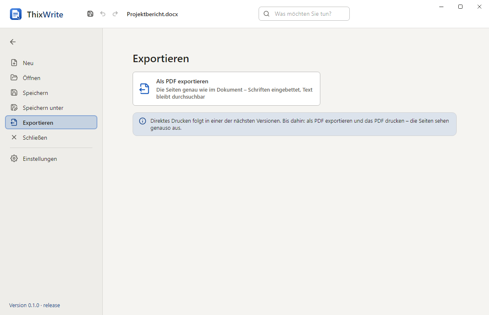
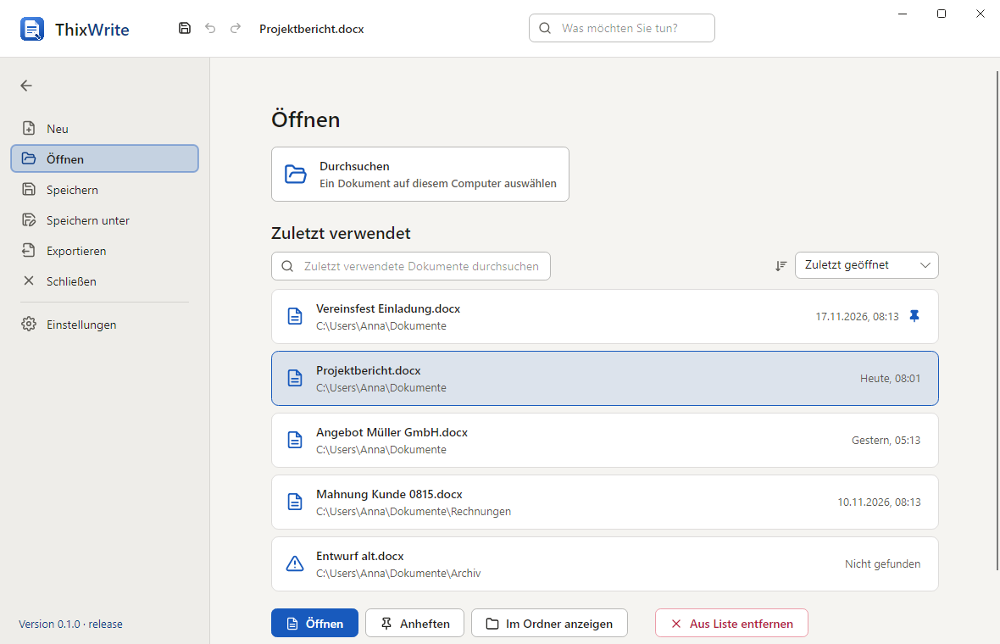
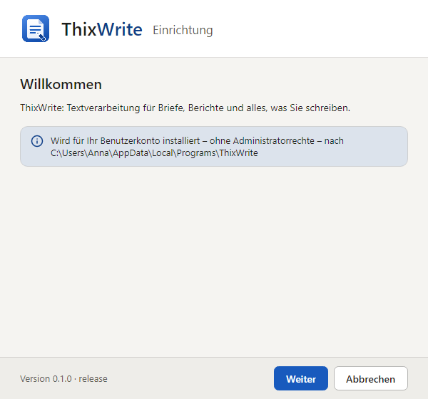

# ThixOffice


Eine Office-Suite aus einzelnen Programmen für **Windows und macOS**, die Windows-Nutzer sofort bedienen können –
Menüband, „Datei“ als Backstage, Schnellzugriff und „Was möchten Sie tun?“ dort, wo Word, Excel und PowerPoint sie haben –
und die aussieht wie die übrigen Thix-Apps.

| Programm | statt | Formate | Stand |
| --- | --- | --- | --- |
| **ThixWrite** | Word | docx, txt, später odt | Meilenstein 1a: nativer Editor, docx, PDF-Export |
| **ThixCalc** | Excel | xlsx, csv, später ods | Logo |
| **ThixShow** | PowerPoint | pptx, später odp | Logo |

Der Plan steht in [docs/PLAN.md](docs/PLAN.md).

## ThixWrite – Stand Meilenstein 1a

ThixWrite ist eine Textverarbeitung mit eigenem, nativem Editor: Seiten wie auf Papier (weiß, auch im dunklen
Erscheinungsbild), Zeichen- und Absatzformat, Formatvorlagen, Aufzählung und Nummerierung, Rückgängig/Wiederholen, Zwischenablage
(mit Formatierung zwischen ThixWrite-Fenstern, „Nur Text einfügen“ mit Strg+Umschalt+V), Suchen und Ersetzen, Seite einrichten,
Zoom (auch Strg+Mausrad, Seitenbreite, Ganze Seite), Formatierungszeichen und „Als PDF exportieren“. Eingabemethoden (Umlaute,
Akzente mit Tottasten, Emoji-Panel, chinesisch/japanisch) funktionieren.

Word-Dokumente (.docx) sind das Standardformat; .txt wird als reiner Text gelesen und geschrieben. Inhalte, die ThixWrite noch
nicht anzeigt (Tabellen, Bilder, Kopf-/Fußzeilen, Kommentare …), bleiben beim Speichern erhalten – beim Öffnen sagt ein Hinweis,
welche es sind. Direktes Drucken folgt; bis dahin führt der Weg über das PDF.


| Suchen und Ersetzen (Strg+F, Strg+H) | Layout und Formatierungszeichen |
| --- | --- |
|  |  |
| **Seite einrichten** | **Ansicht › Ganze Seite** |
|  |  |
| **Datei › Exportieren** (PDF) | **Öffnen** |
|  |  |
| **Einstellungen › Speichern** | **Änderungen speichern?** |
|  |  |

### Tastenkürzel

Wie im deutschen Word, wo sie nicht kollidieren (unter macOS ⌘ statt Strg, ⌥ für Wort-Bewegungen):

| Kürzel | Befehl |
| --- | --- |
| Strg+Umschalt+F / K / U (auch Strg+B / I / U) | Fett / Kursiv / Unterstrichen |
| Strg+L / E / R / J | Linksbündig / Zentriert / Rechtsbündig / Blocksatz (Strg+B ist Fett, nicht Blocksatz) |
| Strg+Leertaste (⇧⌘Leertaste) | Formatierung löschen |
| Strg+F / Strg+H (⌥⌘F) | Suchen / Ersetzen |
| Strg+A, Strg+C/X/V, Strg+Umschalt+V | Alles markieren, Zwischenablage, Nur Text einfügen |
| Strg+Eingabe, Umschalt+Eingabe | Seitenumbruch, Zeilenumbruch |
| Tab / Umschalt+Tab | in Listen: Ebene tiefer / höher |
| Alt+Umschalt+D | Datum und Uhrzeit |
| Strg+P | Exportieren (PDF) |
| Strg+Z / Strg+Y (⇧⌘Z), Strg+S, F12, Strg+F1 | Rückgängig / Wiederholen, Speichern, Speichern unter, Menüband |

## Installieren

- **Windows:** `ThixWriteSetup.exe` aus dem Release-Kanal herunterladen und starten. Das Programm installiert sich selbst für
  das eigene Benutzerkonto (ohne Administratorrechte) nach `%LocalAppData%\Programs\ThixWrite`, trägt sich im Startmenü, unter
  „Installierte Apps“ und unter „Öffnen mit“ für Word-Dokumente (.docx) und Textdateien ein – Standardprogramm wird ThixWrite
  nur, wenn Sie es in den „Standard-Apps“ von Windows wählen. Entfernen über „Installierte Apps“.
- **macOS:** `ThixWrite-macOS-arm64.dmg` (Apple Silicon) bzw. `-x64.dmg` (Intel) öffnen und ThixWrite in „Programme“ ziehen.
- Updates kommen automatisch aus dem eigenen Kanal (`release-channel` für main, `nightly-channel` für dev) und werden
  installiert, wenn ThixWrite geschlossen wird – nie mitten in der Arbeit.
- ThixLauncher kann die Apps installieren (je App eigenes Manifest `<app>-update.json`, siehe Plan Abschnitt 6).



## Für Administratoren

Richtlinien je App (Wert 1 = an): Windows `HKLM\SOFTWARE\Policies\ThixWrite` (DWORD), macOS ein Konfigurationsprofil für
`info.schmoldt.thixwrite` – `LockConfiguration` (Einstellungen gesperrt), `DisableUpdates`, `DisableCloud`,
`DisableFileAssociations`.

## Entwickeln

```
dotnet build ThixOffice.slnx
dotnet test ThixOffice.slnx
dotnet run --project src/ThixWrite                      # mit THIXWRITE_DATA_DIR=<Ordner> eine eigene Instanz
dotnet run --project src/ThixWrite -- --snapshot shots  # alle Fenster hell und dunkel als PNG
cd tools && npm install && node render-icons.js         # Logos rendern
```

Aufbau, Regeln und wie eine weitere App dazukommt: [CLAUDE.md](CLAUDE.md). Logos: [branding/README.md](branding/README.md).

© Matthias Schmoldt
