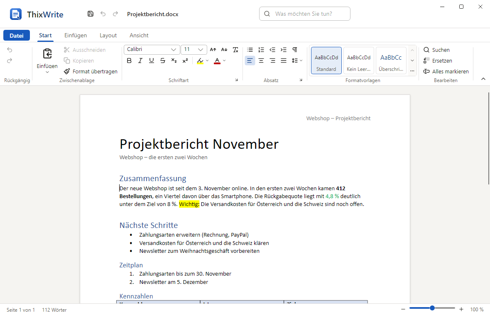
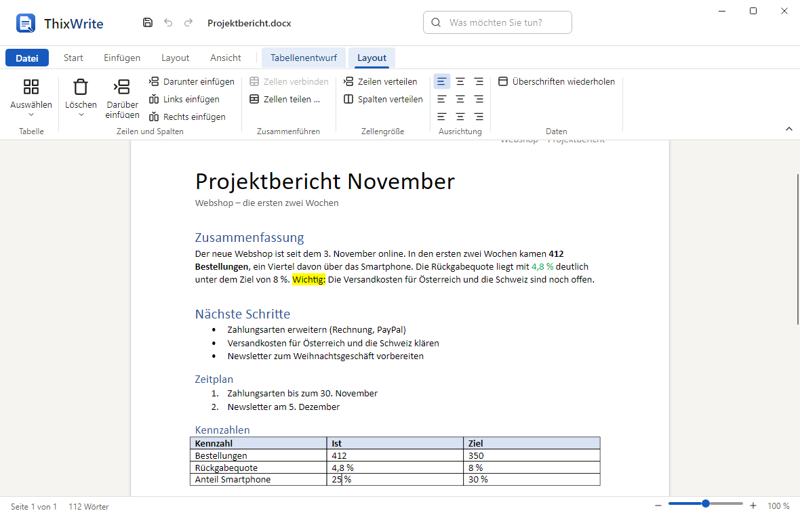
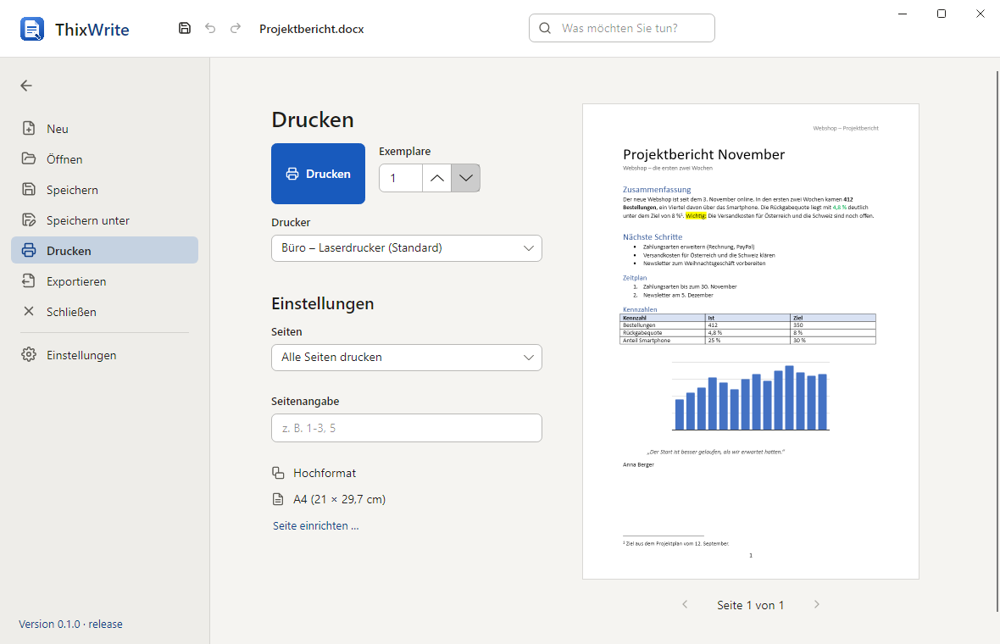
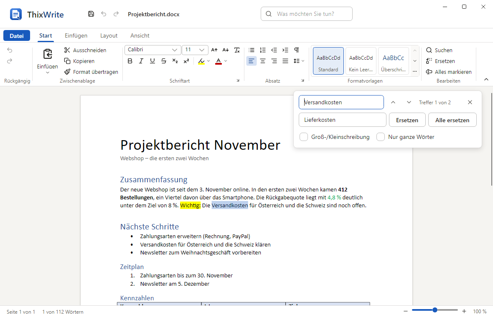
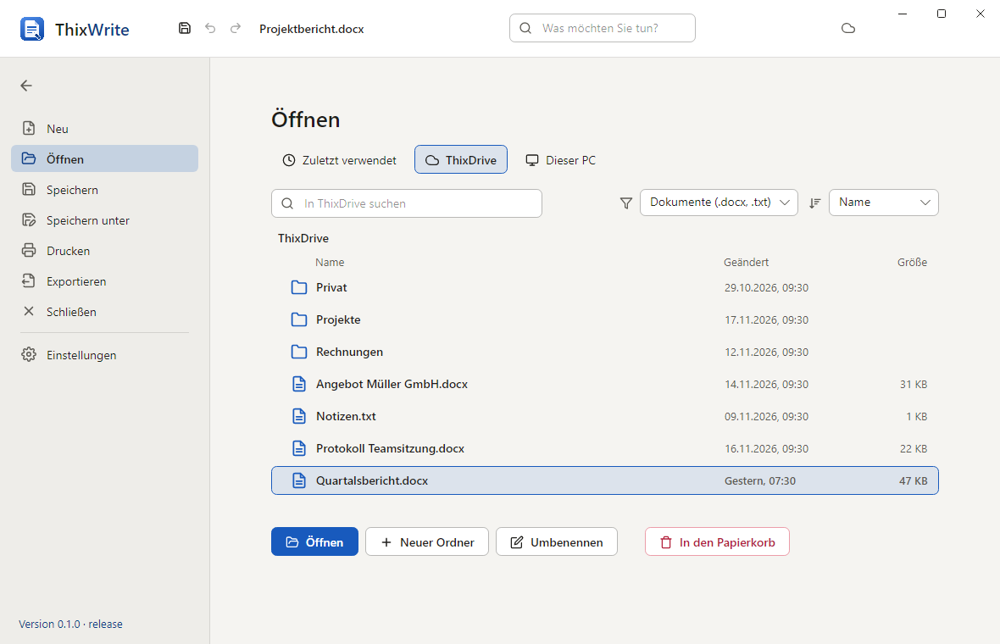
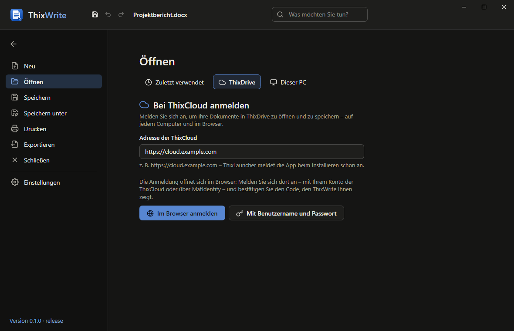
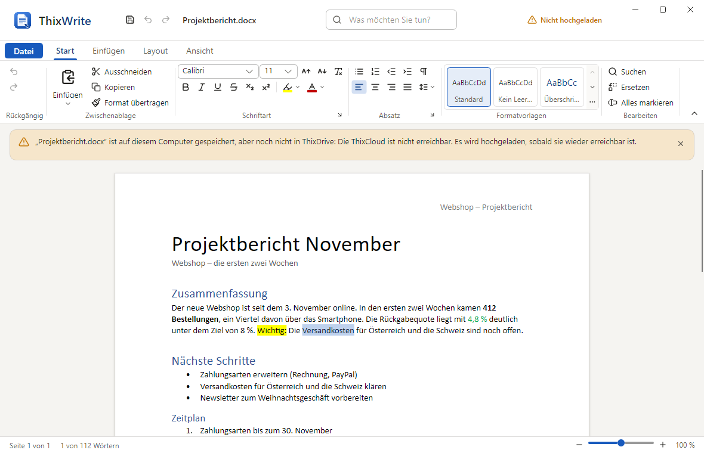
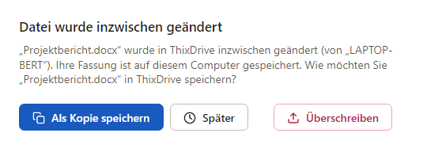

# ThixOffice


Eine Office-Suite aus einzelnen Programmen für **Windows und macOS**, die Windows-Nutzer sofort bedienen können –
Menüband, „Datei“ als Backstage, Schnellzugriff und „Was möchten Sie tun?“ dort, wo Word, Excel und PowerPoint sie haben –
und die aussieht wie die übrigen Thix-Apps.

| Programm | statt | Formate | Stand |
| --- | --- | --- | --- |
| **ThixWrite** | Word | docx, txt, später odt | Meilenstein 1b; Dokumente in ThixDrive (Phase 2) |
| **ThixCalc** | Excel | xlsx, csv, später ods | Logo |
| **ThixShow** | PowerPoint | pptx, später odp | Logo |

Der Plan steht in [docs/PLAN.md](docs/PLAN.md).

## ThixWrite – Stand Meilenstein 1b

ThixWrite ist eine Textverarbeitung mit eigenem, nativem Editor: Seiten wie auf Papier (weiß, auch im dunklen
Erscheinungsbild), Zeichen- und Absatzformat, Formatvorlagen, Aufzählung und Nummerierung, Rückgängig/Wiederholen, Zwischenablage
(mit Formatierung zwischen ThixWrite-Fenstern, „Nur Text einfügen“ mit Strg+Umschalt+V), Suchen und Ersetzen, Seite einrichten,
Zoom (auch Strg+Mausrad, Seitenbreite, Ganze Seite), Formatierungszeichen, „Als PDF exportieren“ und Drucken (Windows und macOS,
mit Vorschau). Dazu Tabellen (Raster einfügen, Zeilen/Spalten, verbinden/teilen, Rahmen, Schattierung, Überschriften wiederholen,
Spaltenbreite ziehen), Bilder (einfügen, einfügen aus der Zwischenablage, ziehen, Größe mit Ziehpunkten, Alternativtext), Kopf- und
Fußzeilen mit Seitenzahlen (Doppelklick in den Rand), Links, Lineal mit Einzügen und Tabstopps, die Dialoge Schriftart und Absatz,
Format übertragen, Symbole und Einfügen aus anderen Programmen (HTML: Formatierung, Listen, Tabellen, Links, Bilder). Eingabemethoden
(Umlaute, Akzente mit Tottasten, Emoji-Panel, chinesisch/japanisch) funktionieren.

Word-Dokumente (.docx) sind das Standardformat; .txt wird als reiner Text gelesen und geschrieben. Inhalte, die ThixWrite noch
nicht anzeigt (Kommentare, Fußnoten, verschachtelte Tabellen, Formeln …), bleiben beim Speichern erhalten – beim Öffnen sagt ein
Hinweis, welche es sind.




| Tabelle (Kontext-Karte Layout) | Bild (Kontext-Karte Bildformat) |
| --- | --- |
|  |  |
| **Kopfzeile bearbeiten** (Doppelklick in den Rand) | **Datei › Drucken** (Strg+P) |
|  |  |
| **Suchen und Ersetzen** (Strg+F, Strg+H) | **Layout und Formatierungszeichen** |
|  |  |
| **Seite einrichten** | **Ansicht › Ganze Seite** |
|  |  |
| **Datei › Exportieren** (PDF) | **Öffnen** |
|  |  |
| **Einstellungen › Speichern** | **Änderungen speichern?** |
|  |  |

## ThixCloud und ThixDrive

ThixWrite öffnet und speichert Dokumente direkt in **ThixDrive**, der Ablage Ihrer **ThixCloud** (MatCloud) – auf jedem
Computer und im Browser. ThixCalc und ThixShow bekommen dasselbe, sobald es sie gibt.

**Verbinden:**

1. *Datei › Einstellungen › Cloud* (oder *Datei › Öffnen › ThixDrive*): die Adresse Ihrer ThixCloud eintragen
   (z. B. `https://cloud.example.com`).
2. **Im Browser anmelden** (empfohlen, für jedes Konto, auch über MatIdentity): ThixWrite zeigt einen Code und öffnet die
   Anmeldeseite; dort anmelden und prüfen, dass derselbe Code steht – ThixWrite verbindet sich, sobald Sie bestätigen.
   Oder **Mit Benutzername und Passwort** eines Kontos der ThixCloud. Das Passwort wird nur für die Anmeldung verwendet und nie
   gespeichert; das Geräte-Token liegt geschützt (Windows: DPAPI, macOS: Schlüsselbund).
3. Hat **ThixLauncher** ThixWrite installiert, ist es beim ersten Start schon angemeldet.

Abmelden unter *Einstellungen › Cloud* entfernt diesen Computer aus Ihrem Konto; Ihre Dokumente bleiben, wo sie sind.

**Arbeiten:** *Datei › Öffnen* und *Datei › Speichern unter* haben die Orte „Zuletzt verwendet“, „ThixDrive“ und „Dieser PC“.
In ThixDrive suchen Sie über die ganze Ablage, filtern nach Typ, sortieren, legen Ordner an, benennen um und legen in den
Papierkorb (30 Tage, im Browser wiederherstellbar). Strg+S speichert ein ThixDrive-Dokument zuerst auf diesem Computer, dann
als neue Version in ThixDrive; oben rechts in der Titelleiste steht, wo es steht („In ThixDrive“, „Wird hochgeladen …“).

- **Ohne Verbindung geht nichts verloren:** Das Dokument bleibt gespeichert (als Arbeitskopie auf diesem Computer) und ist als
  **„Nicht hochgeladen“** markiert; ThixWrite versucht es alle 30 Sekunden erneut, ein Klick darauf sofort. Beim Schließen
  fragt ThixWrite nach; wer trotzdem schließt, dem wird es beim nächsten Öffnen hochgeladen.
- **Hat jemand die Datei inzwischen geändert**, fragt ThixWrite: **Als Kopie speichern** (Vorschlag – beide Fassungen bleiben),
  **Später** oder – abgesetzt – **Überschreiben** (Ihre Fassung wird die aktuelle; die andere bleibt als ältere Version).
- Ist der Speicherplatz voll oder die Datei zu groß, sagt ThixWrite das; das Dokument bleibt auf diesem Computer gespeichert.

| | |
| --- | --- |
|  |  |
|  |  |
|  |  |

### Tastenkürzel

Wie im deutschen Word, wo sie nicht kollidieren (unter macOS ⌘ statt Strg, ⌥ für Wort-Bewegungen):

| Kürzel | Befehl |
| --- | --- |
| Strg+Umschalt+F / K / U (auch Strg+B / I / U) | Fett / Kursiv / Unterstrichen |
| Strg+L / E / R / J | Linksbündig / Zentriert / Rechtsbündig / Blocksatz (Strg+B ist Fett, nicht Blocksatz) |
| Strg+Leertaste (⇧⌘Leertaste) | Formatierung löschen |
| Strg+F / Strg+H (⌥⌘F) | Suchen / Ersetzen |
| Strg+A, Strg+C/X/V, Strg+Umschalt+V | Alles markieren, Zwischenablage, Nur Text einfügen |
| Strg+Eingabe, Umschalt+Eingabe | Seitenumbruch, Zeilenumbruch |
| Tab / Umschalt+Tab | in Listen: Ebene tiefer / höher; in Tabellen: nächste / vorige Zelle (Tab in der letzten Zelle: neue Zeile) |
| Alt+Umschalt+D | Datum und Uhrzeit |
| Strg+P | Drucken |
| Strg+K, Strg+Klick | Link einfügen, Link öffnen |
| Strg+D | Schriftart … |
| Strg+Umschalt+C | Format übertragen |
| Esc (in Kopf-/Fußzeile) | zurück zum Text |
| Strg+Z / Strg+Y (⇧⌘Z), Strg+S, F12, Strg+F1 | Rückgängig / Wiederholen, Speichern, Speichern unter, Menüband |

## Installieren

- **Windows:** `ThixWriteSetup.exe` aus dem Release-Kanal herunterladen und starten. Das Programm installiert sich selbst für
  das eigene Benutzerkonto (ohne Administratorrechte) nach `%LocalAppData%\Programs\ThixWrite`, trägt sich im Startmenü, unter
  „Installierte Apps“ und unter „Öffnen mit“ für Word-Dokumente (.docx) und Textdateien ein – Standardprogramm wird ThixWrite
  nur, wenn Sie es in den „Standard-Apps“ von Windows wählen. Entfernen über „Installierte Apps“.
- **macOS:** `ThixWrite-macOS-arm64.dmg` (Apple Silicon) bzw. `-x64.dmg` (Intel) öffnen und ThixWrite in „Programme“ ziehen.
- Updates kommen automatisch aus dem eigenen Kanal (`release-channel` für main, `nightly-channel` für dev) und werden
  installiert, wenn ThixWrite geschlossen wird – nie mitten in der Arbeit.
- ThixLauncher kann die Apps installieren (je App eigenes Manifest `<app>-update.json`, siehe Plan Abschnitt 6).


## Für Administratoren

Richtlinien je App (Wert 1 = an): Windows `HKLM\SOFTWARE\Policies\ThixWrite` (DWORD), macOS ein Konfigurationsprofil für
`info.schmoldt.thixwrite` – `LockConfiguration` (Einstellungen gesperrt), `DisableUpdates`, `DisableCloud` (keine Anmeldung
an der ThixCloud, kein ThixDrive), `DisableFileAssociations`, `DisablePrinting`. In der ThixCloud selbst lässt sich ThixDrive (oder
die App) für alle abschalten; ThixWrite zeigt dann „von der Verwaltung abgeschaltet“.

## Entwickeln

```
dotnet build ThixOffice.slnx
dotnet test ThixOffice.slnx
dotnet run --project src/ThixWrite                      # mit THIXWRITE_DATA_DIR=<Ordner> eine eigene Instanz
dotnet run --project src/ThixWrite -- --snapshot shots  # alle Fenster hell und dunkel als PNG
cd tools && npm install && node render-icons.js         # Logos rendern
```

Aufbau, Regeln und wie eine weitere App dazukommt: [CLAUDE.md](CLAUDE.md). Logos: [branding/README.md](branding/README.md).

© Matthias Schmoldt
