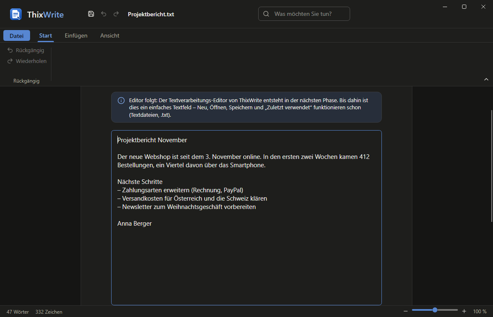
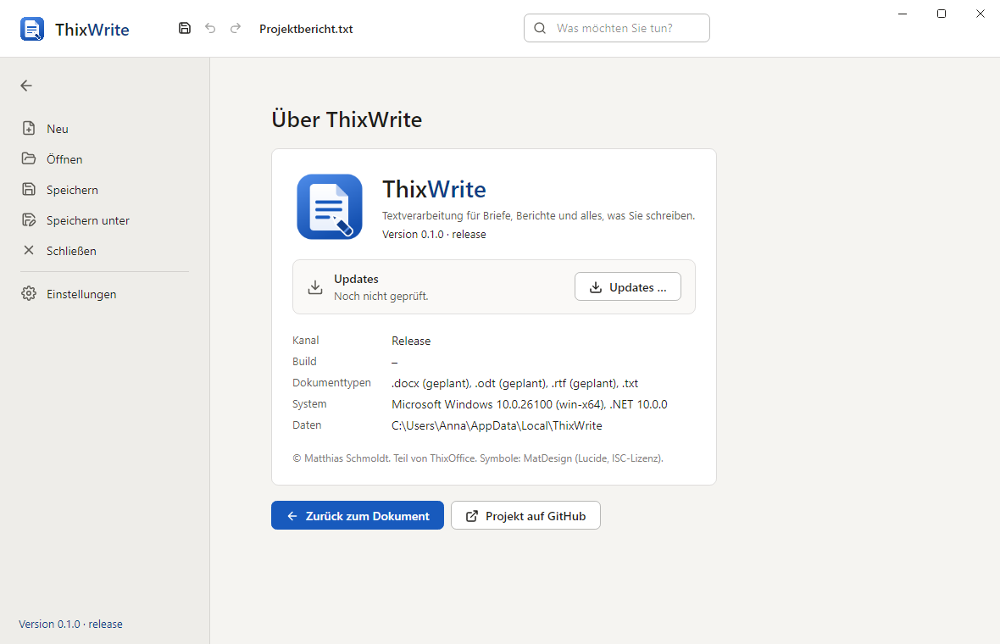

# ThixOffice


Eine Office-Suite aus einzelnen Programmen für **Windows und macOS**, die Windows-Nutzer sofort bedienen können –
Menüband, „Datei“ als Backstage, Schnellzugriff und „Was möchten Sie tun?“ dort, wo Word, Excel und PowerPoint sie haben –
und die aussieht wie die übrigen Thix-Apps.

| Programm | statt | Formate | Stand |
| --- | --- | --- | --- |
| **ThixWrite** | Word | docx, später odt | Phase 0: Fundament, Editor folgt |
| **ThixCalc** | Excel | xlsx, csv, später ods | Logo |
| **ThixShow** | PowerPoint | pptx, später odp | Logo |

Der Plan steht in [docs/PLAN.md](docs/PLAN.md).

## ThixWrite – Stand Phase 0

Das Fenster mit Titelleiste (Logo, Schnellzugriff, Dokumentname, Befehlssuche), Menüband (Start, Einfügen, Ansicht – es
füllt sich mit dem Editor; Strg+F1 reduziert es, Alt zeigt die Tastaturtipps), Statusleiste mit Zoom und „Datei“ (Neu,
Öffnen mit „Zuletzt verwendet“, Speichern, Speichern unter, Schließen, Einstellungen, Info) ist fertig. Der Textverarbeitungs-Editor
selbst entsteht in der nächsten Phase; bis dahin bearbeitet ThixWrite einfache Textdateien (.txt), damit Neu, Öffnen,
Speichern, „Zuletzt verwendet“, die Wiederherstellung nach einem Absturz und die Frage „Änderungen speichern?“ schon echt
funktionieren. Word-Dateien (.docx) öffnet ThixWrite erst, wenn es sie lesen kann – vorher werden sie weder angeboten noch
überschrieben.




| Öffnen | Einstellungen › Speichern |
| --- | --- |
|  |  |
| **Info** (über die Versionsnummer unten links) | **Änderungen speichern?** |
|  |  |

## Installieren

- **Windows:** `ThixWriteSetup.exe` aus dem Release-Kanal herunterladen und starten. Das Programm installiert sich selbst für
  das eigene Benutzerkonto (ohne Administratorrechte) nach `%LocalAppData%\Programs\ThixWrite`, trägt sich im Startmenü, unter
  „Installierte Apps“ und unter „Öffnen mit“ ein. Entfernen über „Installierte Apps“.
- **macOS:** `ThixWrite-macOS-arm64.dmg` (Apple Silicon) bzw. `-x64.dmg` (Intel) öffnen und ThixWrite in „Programme“ ziehen.
- Updates kommen automatisch aus dem eigenen Kanal (`release-channel` für main, `nightly-channel` für dev) und werden
  installiert, wenn ThixWrite geschlossen wird – nie mitten in der Arbeit.
- ThixLauncher kann die Apps installieren (je App eigenes Manifest `<app>-update.json`, siehe Plan Abschnitt 6).


## Für Administratoren

Richtlinien je App (Wert 1 = an): Windows `HKLM\SOFTWARE\Policies\ThixWrite` (DWORD), macOS ein Konfigurationsprofil für
`info.schmoldt.thixwrite` – `LockConfiguration` (Einstellungen gesperrt), `DisableUpdates`, `DisableCloud`,
`DisableFileAssociations`.

## Entwickeln

```
dotnet build ThixOffice.slnx
dotnet test ThixOffice.slnx
dotnet run --project src/ThixWrite                      # mit THIXWRITE_DATA_DIR=<Ordner> eine eigene Instanz
dotnet run --project src/ThixWrite -- --snapshot shots  # alle Fenster hell und dunkel als PNG
cd tools && npm install && node render-icons.js         # Logos rendern
```

Aufbau, Regeln und wie eine weitere App dazukommt: [CLAUDE.md](CLAUDE.md). Logos: [branding/README.md](branding/README.md).

© Matthias Schmoldt
