# ThixOffice


Eine Office-Suite aus einzelnen Programmen für **Windows und macOS**, die Windows-Nutzer sofort bedienen können –
Menüband, „Datei“ als Backstage, Schnellzugriff und „Was möchten Sie tun?“ dort, wo Word, Excel und PowerPoint sie haben –
und die aussieht wie die übrigen Thix-Apps.

| Programm | statt | Formate | Stand |
| --- | --- | --- | --- |
| **ThixWrite** | Word | docx, odt, txt | Meilenstein 1c; Dokumente in ThixDrive (Phase 2) |
| **ThixCalc** | Excel | xlsx, xlsm, ods, csv | erstes Release (Phase 3), Arbeitsmappen in ThixDrive |
| **ThixShow** | PowerPoint | pptx, pptm, später odp | erste Version (Phase 4), Präsentationen in ThixDrive |
| **ThixContacts** | Outlook › Personen | vCard (Import/Export), CSV | erste Version (Phase 7a), Kontakte über die ThixCloud abgeglichen |

Der Plan steht in [docs/PLAN.md](docs/PLAN.md).

**PDF in allen drei Programmen:** *Datei › Speichern unter* bietet „PDF (*.pdf)“ als Dateityp an – auf diesem Computer wie in
ThixDrive – und der Befehl „Als PDF speichern“ ist über „Was möchten Sie tun?“ zu finden. Wie in Word entsteht eine Kopie: das
Dokument bleibt die .docx/.xlsx/.pptx, die es war (samt ungespeicherter Änderungen); die Meldung „Als PDF gespeichert“ öffnet das PDF.

## ThixWrite – Stand Meilenstein 1c

ThixWrite ist eine Textverarbeitung mit eigenem, nativem Editor: Seiten wie auf Papier (weiß, auch im dunklen
Erscheinungsbild), Zeichen- und Absatzformat, Formatvorlagen, Aufzählung und Nummerierung, Rückgängig/Wiederholen, Zwischenablage
(mit Formatierung zwischen ThixWrite-Fenstern, „Nur Text einfügen“ mit Strg+Umschalt+V), Suchen und Ersetzen, Seite einrichten,
Zoom (auch Strg+Mausrad, Seitenbreite, Ganze Seite), Formatierungszeichen, „Als PDF exportieren“ und Drucken (Windows und macOS,
mit Vorschau). Dazu Tabellen (Raster einfügen, Zeilen/Spalten, verbinden/teilen, Rahmen, Schattierung, Überschriften wiederholen,
Spaltenbreite ziehen), Bilder (einfügen, einfügen aus der Zwischenablage, ziehen, Größe mit Ziehpunkten, Alternativtext), Kopf- und
Fußzeilen mit Seitenzahlen (Doppelklick in den Rand), Links, Lineal mit Einzügen und Tabstopps, die Dialoge Schriftart und Absatz,
Format übertragen, Symbole und Einfügen aus anderen Programmen (HTML: Formatierung, Listen, Tabellen, Links, Bilder). Eingabemethoden
(Umlaute, Akzente mit Tottasten, Emoji-Panel, chinesisch/japanisch) funktionieren.

Meilenstein 1c bringt die Karte **Referenzen**: **Fußnoten** (Strg+Alt+F) stehen unten auf ihrer Seite unter einem kurzen Strich,
lange Fußnoten laufen auf der nächsten Seite weiter; **Endnoten** (Strg+Alt+D) folgen nach dem Text (i, ii, iii …). Den Text einer
Notiz schreiben Sie direkt an Ort und Stelle; ein Klick auf eine Fußnote öffnet sie, ein Doppelklick auf ihre Nummer im Text auch.
Das **Inhaltsverzeichnis** entsteht aus den Überschriften (mit Punkten und Seitenzahlen, jeder Eintrag springt per Strg+Klick zur
Überschrift), „Tabelle aktualisieren“ bringt es auf den neuesten Stand – in Word bleibt es ein echtes, aktualisierbares Verzeichnis.
Ansicht › **Navigationsbereich** zeigt die Überschriften links. Die Karte **Überprüfen** bringt **Kommentare** (Strg+Alt+K): Karten
rechts neben den Seiten, der kommentierte Text ist schattiert, Antworten aus Word erscheinen unter ihrem Kommentar; als Autor gilt der
Benutzername aus Einstellungen › Allgemein (leer: Ihr Name aus dem System). Die **Rechtschreibprüfung** nutzt die Wörterbücher Ihres
Systems (Windows: Sprachpakete; macOS: die Rechtschreibung des Systems) – unbekannte Wörter bekommen eine rote Wellenlinie, ein
Rechtsklick zeigt Vorschläge, **F7** geht Wort für Wort durch das Dokument; Überprüfen › Sprache legt die Sprache des Dokuments fest,
Wörter zählen zählt Seiten, Wörter und Zeichen. Abschalten lässt sie sich in Einstellungen › Allgemein.

Word-Dokumente (.docx) sind das Standardformat; **OpenDocument-Text (.odt)** aus LibreOffice und Co. wird gelesen und geschrieben
(Absätze, Zeichen- und Absatzformat, Formatvorlagen, Listen, Tabellen, Bilder, Kopf- und Fußzeile, Seite einrichten, Links, Fuß- und
Endnoten, Kommentare); .txt wird als reiner Text gelesen und geschrieben. Inhalte, die ThixWrite noch
nicht anzeigt (Kommentare, verschachtelte Tabellen, Formeln …), bleiben beim Speichern erhalten – beim Öffnen sagt ein
Hinweis, welche es sind.

Dokumente aus Word sehen aus wie in Word: Deckblätter, frei positionierte Bilder, Formen, Textfelder und Gruppen stehen an ihrem
Platz und der Text fließt um sie herum; Diagramme und SmartArt werden aus der Datei gezeichnet; Tabellenformatvorlagen zeigen ihre
Überschriftszeile und Bänder; Spalten, Initialen, Seitenfarbe, Absatzrahmen, Kapitälchen und ausgeblendeter Text werden wie in Word
dargestellt, nachverfolgte Änderungen als Endfassung (Überprüfen › Alle Änderungen annehmen/ablehnen). Neu im Menüband: Layout ›
Spalten und Umbrüche, Entwurf › Designs, Farben, Schriftarten, Wasserzeichen (Text oder Bild, wie Word in jeder Kopfzeile) und
Seitenfarbe, Start › Groß-/Kleinschreibung (Umschalt+F3); die Tasten sind die des deutschen Word
(Strg+Umschalt+F/K/U, Strg+B Blocksatz, Strg+1/2/5, Strg+Umschalt+N, Alt+1/2/3, Strg+M).


| Tabelle (Kontext-Karte Layout) | Bild (Kontext-Karte Bildformat) |
| --- | --- |
|  | 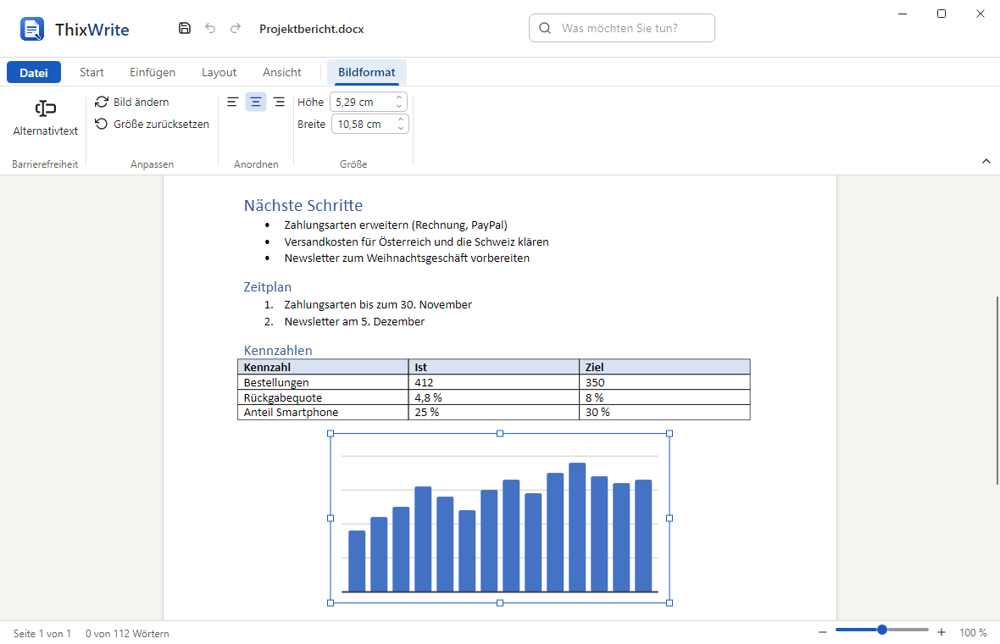 |
| **Referenzen** (Fußnote am Seitenende, Navigationsbereich) | **Überprüfen** (Kommentare) |
| 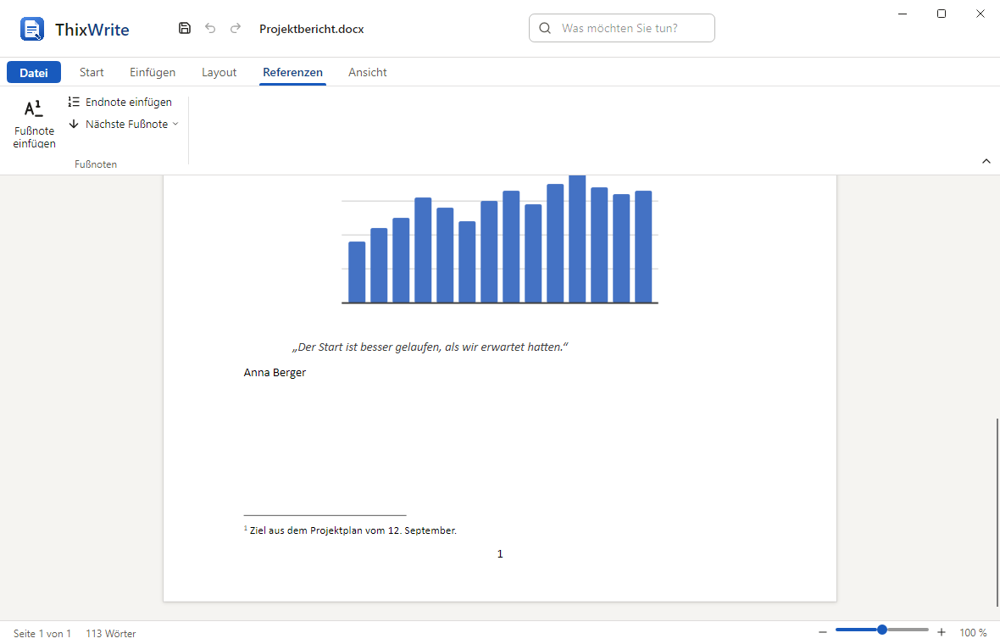 | 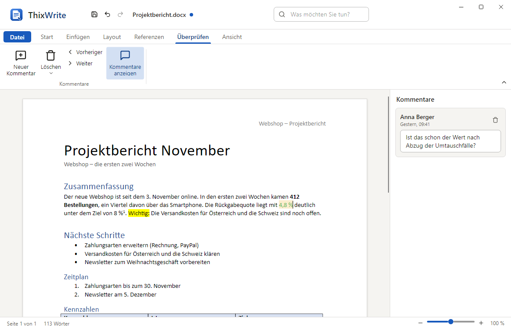 |
| **Rechtschreibung** (Wellenlinie unter einem Tippfehler) | **Rechtschreibung (F7)** |
| 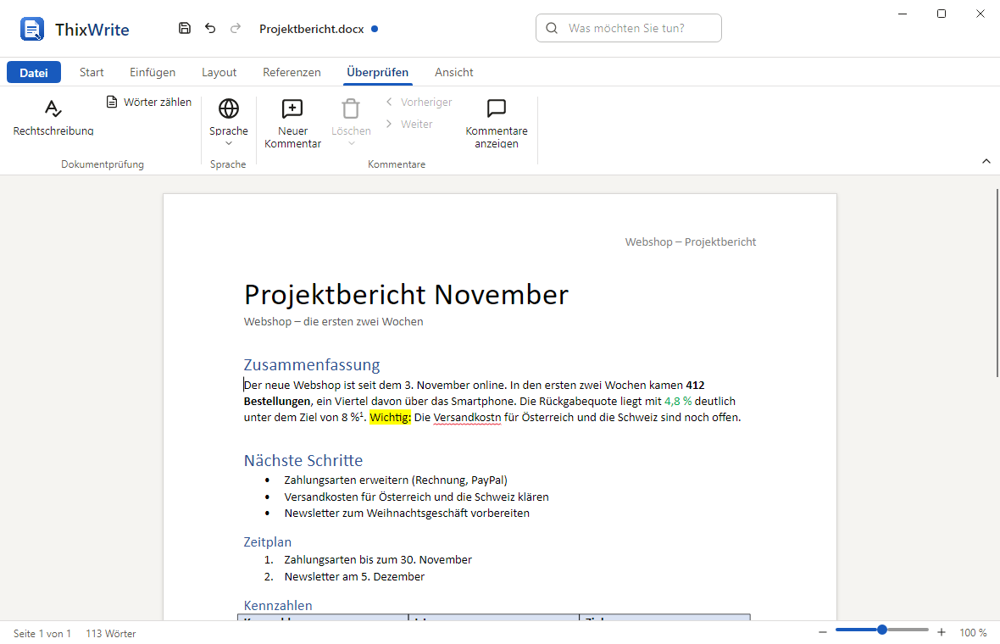 | 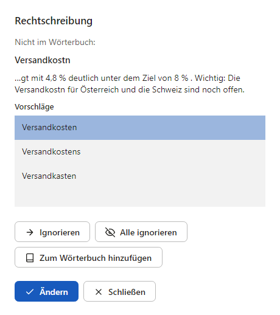 |
| **Kopfzeile bearbeiten** (Doppelklick in den Rand) | **Datei › Drucken** (Strg+P) |
| 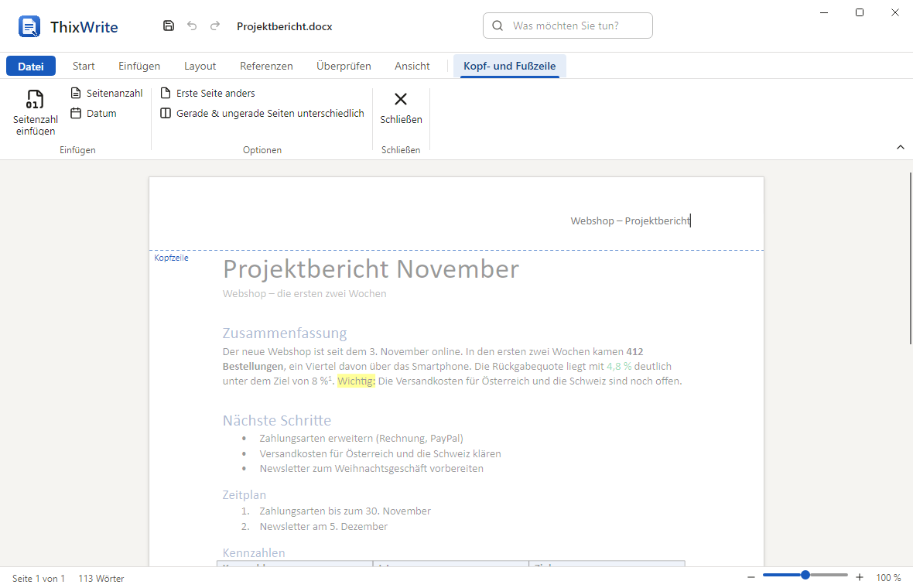 |  |
| **Suchen und Ersetzen** (Strg+F, Strg+H) | **Layout und Formatierungszeichen** |
|  | 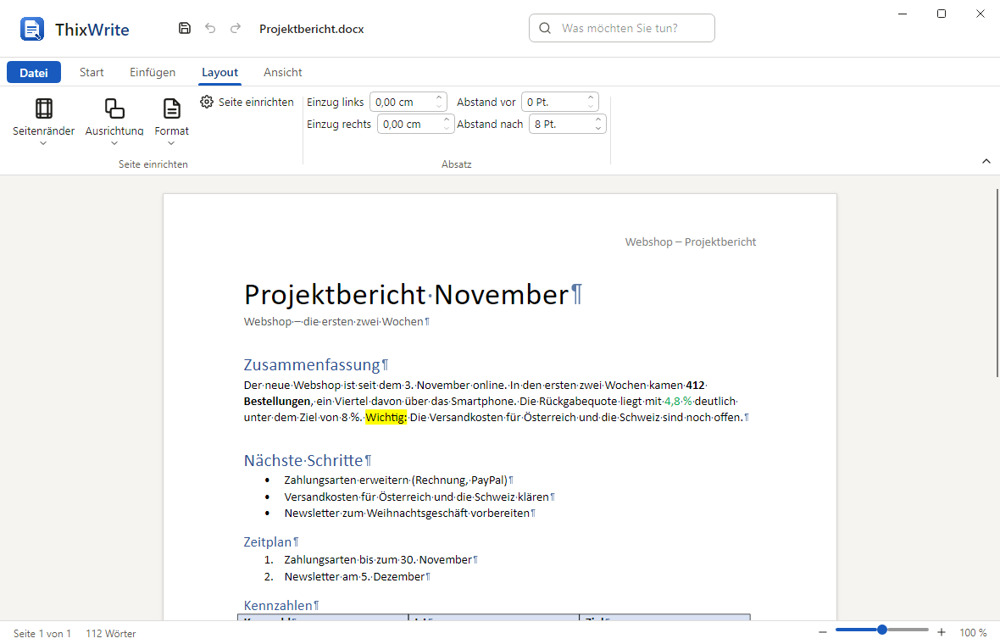 |
| **Seite einrichten** | **Ansicht › Ganze Seite** |
| 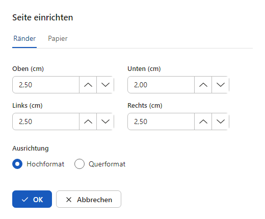 | 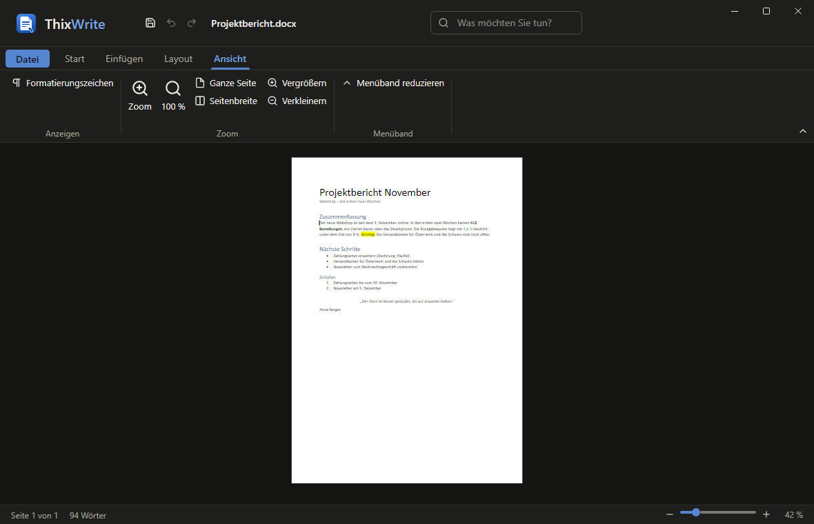 |
| **Datei › Exportieren** (PDF) | **Öffnen** |
|  |  |
| **Einstellungen › Speichern** | **Änderungen speichern?** |
| 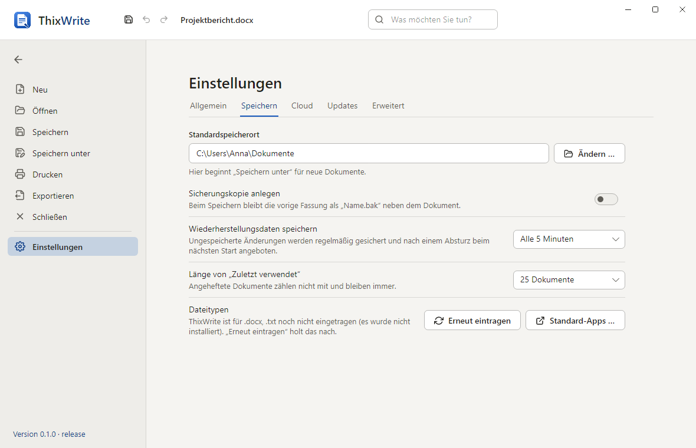 |  |

## ThixCalc – erstes Release

ThixCalc ist eine Tabellenkalkulation mit eigenem, nativem Raster und eigener Formel-Engine: alle 520 Funktionen des aktuellen
Excel mit deutschen Namen und deutscher Hilfe (SUMME, SVERWEIS, XVERWEIS, SUMMEWENNS, FILTER, GRUPPIERENNACH, PIVOTMIT, LAMBDA,
REGEXEXTRACT, die Wertpapierfunktionen KURS/RENDITE/DURATION …); 506 davon rechnen, 14 brauchen das Internet oder einen OLAP-Server
(CUBE…, RTD, BÖRSENHISTORIE, BILD, ÜBERSETZEN, COPILOT …) und behalten den Wert aus der Datei. Englische Namen (VLOOKUP) und
Kommas als Trennzeichen werden beim Tippen verstanden. Das Raster scrollt pixelgenau und bleibt auch bei
100.000 Zeilen flüssig; Linien sind bei jedem Zoom und jeder Bildschirmskalierung scharf.

- **Eingeben wie in Excel:** Tippen ersetzt (*Eingeben*), F2 oder Doppelklick bearbeitet (*Bearbeiten*), in Formeln zeigen Pfeiltasten
  und Klicks Bezüge (*Zeigen*) – jeder Bezug bekommt eine Farbe in der Formel und denselben farbigen Rahmen im Raster; F4 wechselt
  $A$1 → A$1 → $A1 → A1. Beim Tippen eines Namens erscheint die Funktionsliste (Tab übernimmt), in den Klammern der Argument-Tipp
  „SVERWEIS(Suchkriterium; Matrix; Spaltenindex; [Bereich_Verweis])“. Eingabe/Tab bewegen sich innerhalb der Markierung,
  Strg+Eingabe füllt alle markierten Zellen, Strg+Umschalt+Eingabe gibt eine Matrixformel ein. Eingabemethoden (Umlaute, Tottasten,
  CJK) funktionieren direkt in der Zelle.
- **Bearbeitungsleiste** mit Namenfeld (Zelle, Bereich, „Tabelle2!B4“ oder Name eingeben und Eingabe; ein neuer Name wird definiert),
  fx (Funktion einfügen mit Suche nach deutschem oder englischem Namen und Beschreibung, dann **Funktionsargumente** wie in Excel: ein
  Feld je Argument, daneben sein aktueller Wert, darunter das Formelergebnis; fx auf einer Zelle mit einer Funktion öffnet ihre
  Argumente), aufklappbar für lange Formeln. Formeln › Funktionsbibliothek listet je Kategorie alle Funktionen, „Was möchten Sie
  tun?“ findet jede Funktion („SVERWEIS“, „vlookup“).
- **Maus:** markieren, Umschalt/Strg-Klick, Zeilen- und Spaltenköpfe, Spaltenbreite und Zeilenhöhe ziehen (Doppelklick: optimal),
  Ausfüllkästchen ziehen (Reihen: 1, 2, 3 …, Monate, Wochentage, Datumswerte), Kontextmenüs für Zellen, Zeilen, Spalten und Blätter.
- **Blätter** unten links: neu, umbenennen per Doppelklick, ziehen zum Verschieben, Registerfarbe, ausblenden/einblenden, verschieben
  oder kopieren. Die Statusleiste zeigt Bereit/Eingeben/Bearbeiten/Zeigen und Mittelwert, Anzahl, Summe (Rechtsklick: auswählen).
- **Menüband wie im deutschen Excel:** Start (Zwischenablage mit Inhalte einfügen, Schriftart, Rahmen, Füll- und Schriftfarbe,
  Ausrichtung, Verbinden, Zahlenformate, Bedingte Formatierung mit Regeln, Datenbalken und Farbskalen, Zellenformatvorlagen, Zellen
  einfügen/löschen/formatieren, AutoSumme, Ausfüllen, Löschen, Sortieren und Filtern, Suchen), Einfügen (Link, Notiz), Seitenlayout,
  Formeln (Funktionsbibliothek, Namens-Manager, Formeln anzeigen, Berechnung), Daten (Sortieren, Filtern, Text in Spalten, Duplikate
  entfernen, Datenüberprüfung, Gruppieren), Überprüfen (Notizen), Ansicht (Gitternetzlinien, Überschriften, Bearbeitungsleiste, Zoom,
  Fenster fixieren). Dialog **Zellen formatieren** (Strg+1) mit Zahlen | Ausrichtung | Schrift | Rahmen | Ausfüllen.
- **Zwischenablage:** zwischen ThixCalc-Fenstern exakt (Formeln, Formate), für andere Programme als Text und HTML-Tabelle; Tabellen
  aus Browsern oder Word und Text werden Zelle für Zelle übernommen. **Inhalte einfügen …** (Strg+Alt+V): Werte, Formeln, Formate,
  Alles außer Rahmen, Werte und Zahlenformate, Vorgang (Addieren, Subtrahieren, Multiplizieren, Dividieren), Leerzellen überspringen,
  Transponieren.
- **Filtern:** Werteliste mit Suche, Sortieren aus dem Filtermenü, Zahlen-, Text- und Datumsfilter (Größer als, Zwischen, Beginnt mit,
  Enthält, Vor, Nach …) im Dialog **Benutzerdefinierter AutoFilter** mit Und/Oder, Top 10 (Elemente oder Prozent), über/unter dem
  Durchschnitt. **Ausfüllen › Reihe …** (arithmetisch, geometrisch, Datum in Tagen, Wochentagen, Monaten, Jahren; Inkrement, Endwert).
  **Alle suchen** in der Suchleiste listet jeden Treffer. Rückgängig wirkt auch innerhalb einer gerade bearbeiteten Zelle. Gedrehter
  Text und „An Zellgröße anpassen“ werden gezeichnet; teilweise formatierter Text in Zellen bleibt beim Speichern erhalten.
- **Drucken und PDF:** Seite einrichten (Papier, Hoch-/Querformat, Ränder, Skalierung oder „auf N × M Seiten“, Druckbereich,
  Wiederholungszeilen, Gitternetzlinien, Überschriften, Kopf- und Fußzeile mit Seitenzahl), Datei › Drucken mit Vorschau (aktives
  Blatt, ganze Mappe oder Auswahl), Datei › Exportieren als PDF.
- **Tabellen** (Einfügen › Tabelle, Strg+T oder Strg+L; Start › Als Tabelle formatieren): Überschriften mit Filterpfeilen, gebänderte
  Zeilen und Formatvorlagen in den Designfarben, Ergebniszeile mit TEILERGEBNIS, die Tabelle wächst beim Tippen darunter oder daneben.
  Strukturierte Verweise wie in Excel: `=SUMME(Tabelle1[Umsatz])`, `[@Menge]*[@Preis]`, `Tabelle1[[#Kopfzeilen];[Name]]`,
  `#Ergebnisse`; Umbenennen von Tabelle oder Spalte ändert die Formeln mit. Karte **Tabellenentwurf** (Tabellenname, Tabellengröße
  ändern, In Bereich konvertieren, Tabellenformatoptionen, Tabellenformatvorlagen).
- **PivotTables** (Einfügen › PivotTable): aus einem Bereich oder einer Tabelle, auf ein neues oder vorhandenes Blatt. Rechts die
  Liste **PivotTable-Felder** wie in Excel: Felder ankreuzen (Zahlen landen in Werte, Texte in Zeilen), zwischen Filter, Spalten,
  Zeilen und Werte ziehen oder über das Menü jedes Felds verschieben. Werte zusammenfassen nach Summe, Anzahl, Mittelwert, Max, Min,
  Produkt, Anzahl Zahlen, StdAbw, Varianz; Werte anzeigen als % des Gesamt-, Zeilen- oder Spaltenergebnisses, Differenz, % Differenz,
  laufende Summe; Datumswerte gruppieren nach Jahren, Quartalen, Monaten, Tagen, Zahlen in Bereichen; Filterpfeile mit Elementliste,
  Beschriftungs- und Wertefilter (Top 10), Sortieren nach Beschriftung oder Wert; Kurz-, Gliederungs- und Tabellenformat,
  Teil- und Gesamtergebnisse, Formatvorlagen. Doppelklick auf einen Wert zeigt die Datensätze dahinter, Aktualisieren (Alt+F5) liest
  die Quelle neu, PIVOTDATENZUORDNEN liest Werte. Excel-PivotTables werden gelesen, berechnet, aktualisiert und unverändert gespeichert;
  PivotTables mit berechneten Feldern oder OLAP-Quellen werden angezeigt und erhalten.
- **Diagramme** (Einfügen › Diagramme): Säulen und Balken (gruppiert, gestapelt, 100 %), Linie (mit Datenpunkten, gestapelt), Kreis
  und Ring, Fläche (gestapelt), Punkt (XY, mit geraden oder interpolierten Linien) und Verbund (Säulen + Linie, auch auf der
  Sekundärachse). Die Reihen kommen wie in Excel aus der Markierung (Überschriften, Kategorien, Datumsachse) und folgen den Zellen
  live. Ein Klick wählt ein Diagramm (Rahmen mit Ziehpunkten): ziehen verschiebt, Ziehpunkte ändern die Größe, Pfeiltasten
  verschieben fein, Entf löscht, Strg+C/V kopiert. Die Karten **Diagrammentwurf** (Diagrammelement hinzufügen: Titel, Achsen,
  Achsentitel, Datenbeschriftungen, Gitternetzlinien, Legende; Farben ändern; Zeile/Spalte wechseln; Daten auswählen; Diagrammtyp
  ändern mit Vorschau) und **Format** (Anordnen, Höhe/Breite). Diagramme werden gedruckt und als PDF exportiert, in .xlsx gelesen und
  geschrieben; Diagrammtypen, die ThixCalc noch nicht zeichnet (3D, Netz, Kurs, Wasserfall …), bleiben erhalten und erscheinen als
  beschrifteter Rahmen.
- **Dateien:** Excel-Arbeitsmappen (.xlsx) sind Standard; .xlsm wird gelesen und mit Makros wieder geschrieben (Makros werden nie
  ausgeführt); CSV mit Erkennung von Trennzeichen und Zeichensatz (bei Zweifel fragt der Textimport) und einem Hinweis beim
  Speichern, dass CSV nur die Werte des aktiven Blatts enthält. Was ThixCalc noch nicht zeigt (Bilder, Formen, Pivot-Tabellen …),
  bleibt beim Speichern erhalten – ein Hinweis nennt es beim Öffnen.
- **OpenDocument-Tabelle (.ods)** aus LibreOffice und Co. wird gelesen und geschrieben: Blätter, Werte, Formeln (OpenFormula, mit
  ihren Ergebnissen), Zahlenformate, Zellformate, Spaltenbreiten und Zeilenhöhen, verbundene Zellen, fixierte Bereiche, Namen,
  Datenüberprüfung, Autofilter, bedingte Formatierung (Regeln mit Format), Notizen, Links, Seite einrichten mit Kopf- und Fußzeile,
  Druckbereich und Wiederholungszeilen. Was eine .ods nicht aufnehmen kann (Diagramme, Farbskalen und Datenbalken, Tabellenformate,
  Gliederungen …), nennt eine Frage vor dem Speichern; was eine .ods hatte und ThixCalc nicht übernimmt (Diagramme, Bilder,
  Datenpilot, Makros, LibreOffice-eigene Funktionen), nennt der Hinweis beim Öffnen.

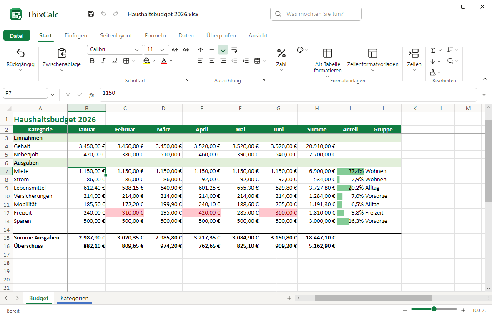

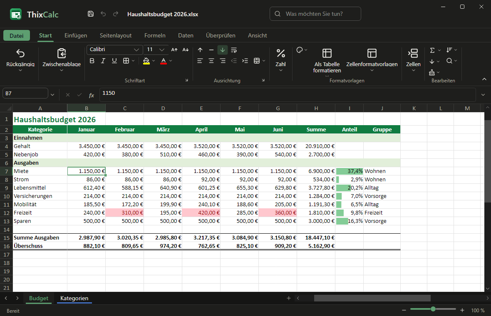

| Formel eingeben (farbige Bezüge, Funktionsliste) | Zellen formatieren (Strg+1) |
| --- | --- |
| 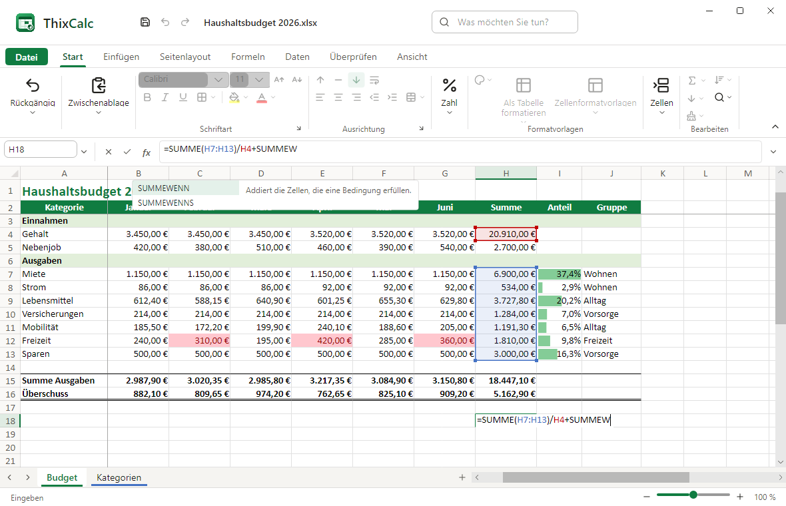 | 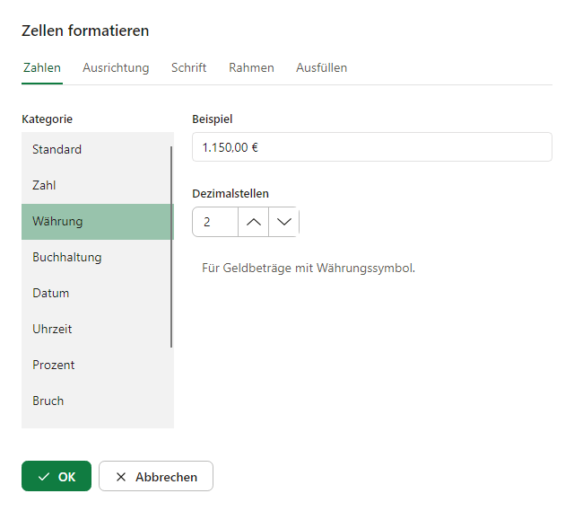 |
| **Funktion einfügen** (Umschalt+F3) | **Suchen und Ersetzen** |
| 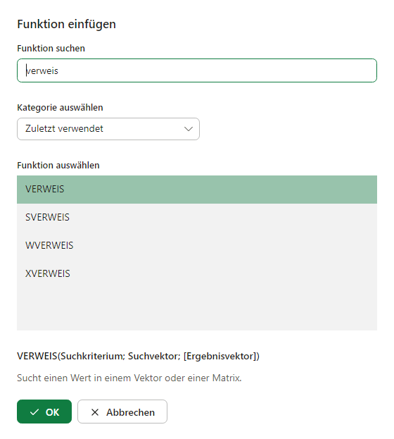 | 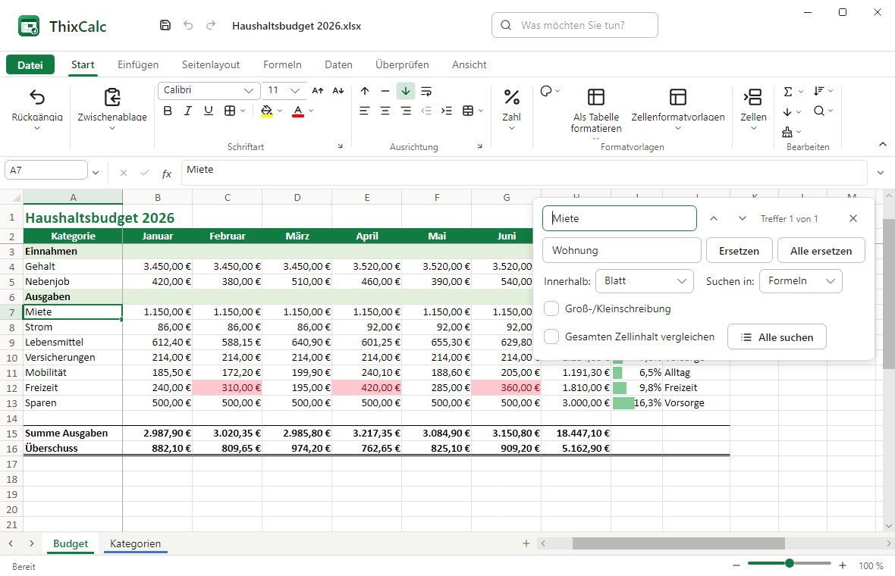 |
| **Datei › Drucken** (Strg+P) | **Seite einrichten** |
| 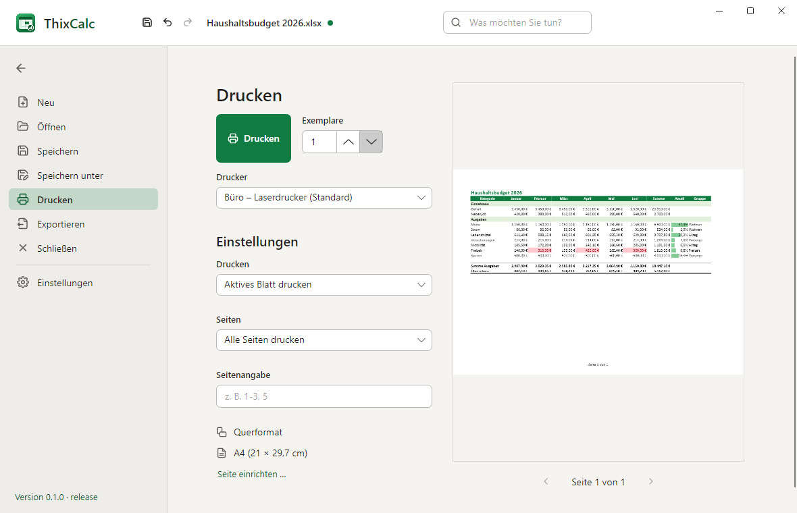 | 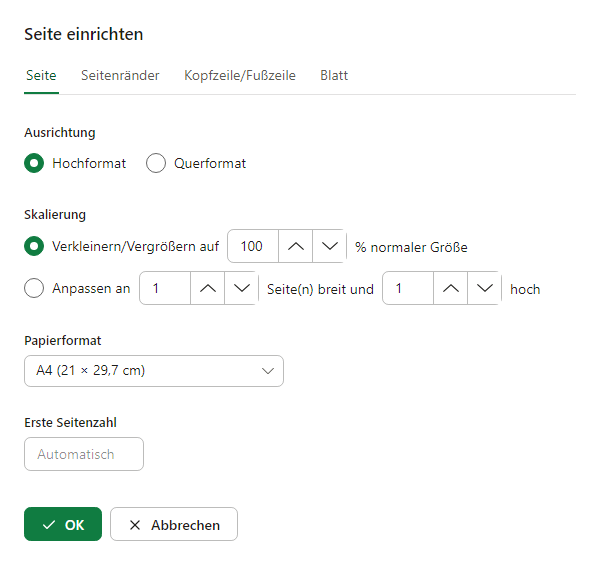 |
| **Diagramme** (Einfügen) | **Diagrammentwurf** |
| 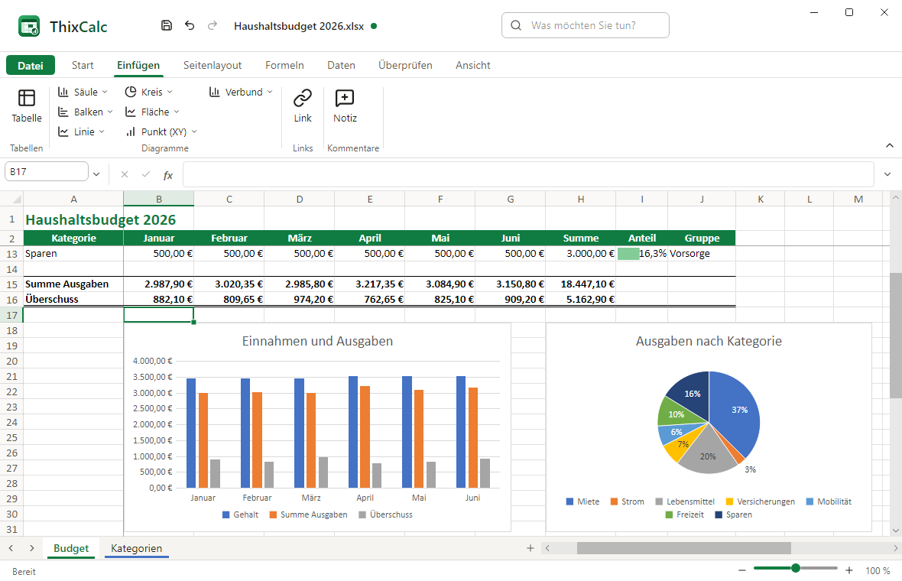 | 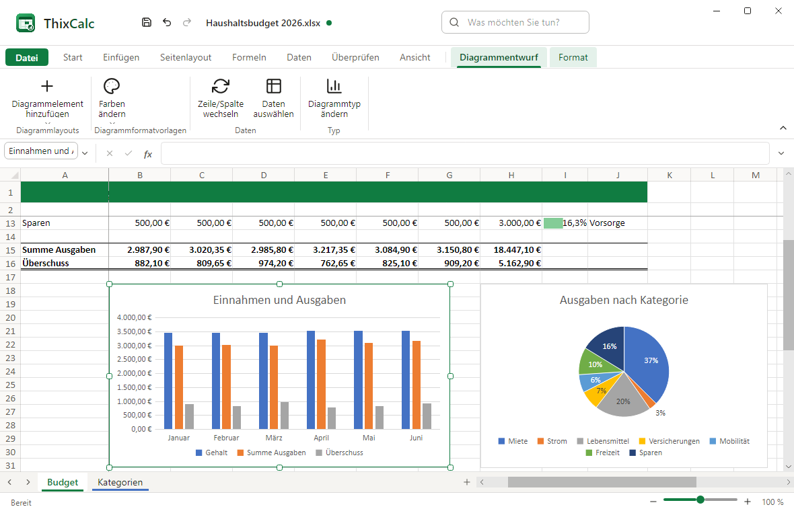 |
| **Tabelle mit Ergebniszeile** (Tabellenentwurf) | |
| 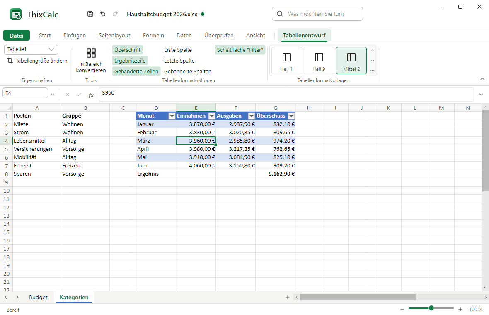 | |
| **Formeln** | **Diagramme dunkel** |
| 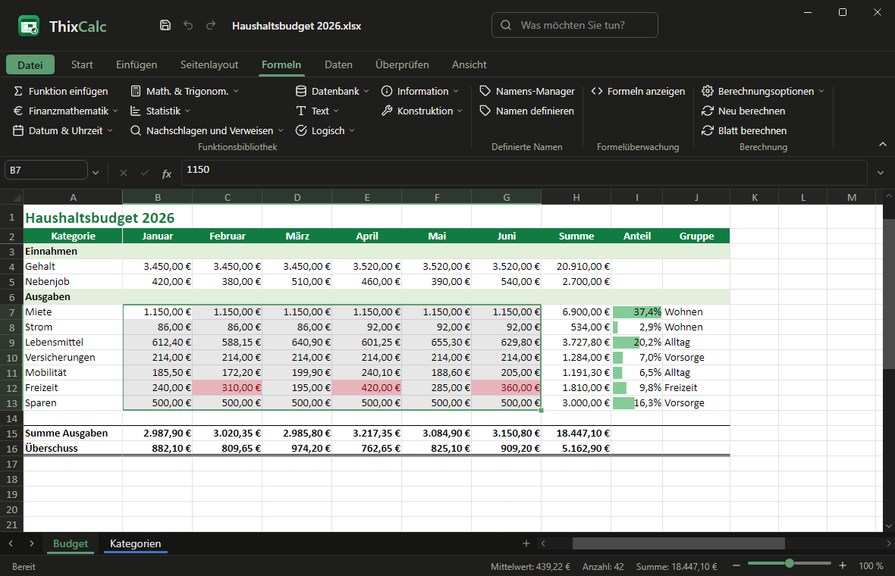 | 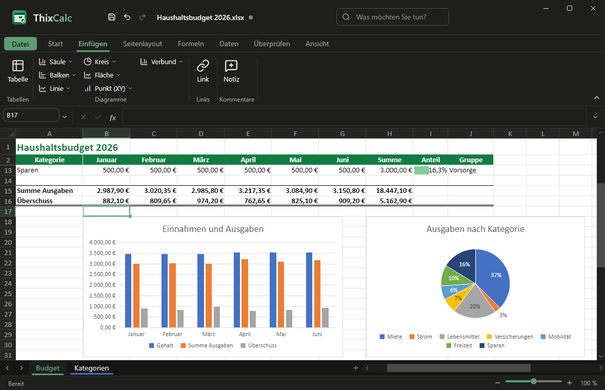 |

### Tastenkürzel in ThixCalc

Wie im deutschen Excel (unter macOS ⌘ statt Strg):

| Kürzel | Befehl |
| --- | --- |
| Pfeile, Strg+Pfeile, Umschalt+…, Pos1, Strg+Pos1 / Strg+Ende | bewegen, zum Datenrand springen, markieren |
| Bild auf/ab, Alt+Bild auf/ab | eine Bildschirmseite nach oben/unten, links/rechts |
| Eingabe / Tab (Umschalt: zurück) | Eingabe beenden und innerhalb der Markierung weiter |
| F2, Esc, F4, Alt+Eingabe | Bearbeiten, Abbrechen, $ in Bezügen, Zeilenumbruch in der Zelle |
| Strg+Eingabe, Strg+Umschalt+Eingabe | alle markierten Zellen füllen, Matrixformel |
| Entf, Rücktaste | Inhalte löschen, Zelle leeren und bearbeiten |
| Strg+Leertaste, Umschalt+Leertaste, Strg+A | Spalte, Zeile, Bereich/alles markieren |
| Strg+Umschalt+F / K / U, Strg+5 (Mac: ⌘B / ⌘I / ⌘U) | Fett, Kursiv, Unterstrichen, Durchgestrichen |
| Strg+1 | Zellen formatieren |
| Strg+Umschalt+4 / 5 / 1 | Buchhaltung (€), Prozent, Zahl mit Tausenderpunkt |
| Strg+U, Strg+R (Mac: ⌘D, ⌘R) | nach unten / nach rechts ausfüllen |
| Alt+Umschalt+0 | AutoSumme |
| Strg+F, Strg+H, F5 | Suchen, Ersetzen, Gehe zu (Namenfeld) |
| Strg+Umschalt+L | Filter ein/aus |
| Strg+K, Umschalt+F2 | Link, Notiz |
| Strg+T, Strg+L | Tabelle erstellen |
| Strg+Alt+V | Inhalte einfügen |
| Strg+Plus, Strg+Minus | Zellen (ganze Zeilen/Spalten, wenn markiert) einfügen, löschen |
| Umschalt+F3, Strg+F3, F9 | Funktion einfügen, Namens-Manager, Neu berechnen |
| Strg+Bild ab / auf (Mac: ⌥⌘→ / ⌥⌘←), Umschalt+F11 | nächstes / voriges Blatt, neues Blatt |
| Strg+9, Strg+0 | Zeilen / Spalten ausblenden |
| Strg+C/X/V, Strg+Umschalt+V, Strg+Z/Y, Strg+S, F12, Strg+P | Zwischenablage, Nur Text, Rückgängig/Wiederholen, Speichern, Speichern unter, Drucken |
| Strg+Mausrad | Zoom |
| Diagramm gewählt: Pfeile (Strg: weiter), Entf, Esc | verschieben, löschen, zurück zu den Zellen |

## ThixShow – erste Version

ThixShow ist das Präsentationsprogramm der Suite – aufgebaut wie PowerPoint: links die Folienminiaturen, in der Mitte die Folie,
darunter die Notizen, unten die Statusleiste mit „Folie 3 von 12“, Notizen, den Ansichten und dem Zoom.

- **Folien:** Neue Folie (Strg+M) mit der Layout-Galerie, Layout ändern, Zurücksetzen, duplizieren (Strg+D), löschen, ausblenden,
  **Abschnitte** (hinzufügen, umbenennen, entfernen; in den Miniaturen auf- und zuklappbar). In den Miniaturen: Klick, Strg-/Umschalt-Klick,
  ziehen zum Umordnen, Pfeiltasten, Entf, Eingabe (neue Folie), Rechtsklick für das Folienmenü. **Foliensortierung** als Raster.
- **Auf der Folie:** markieren mit Klick, Strg/Umschalt oder Rahmen aufziehen; verschieben, Größe ändern (Umschalt: Seitenverhältnis),
  drehen (Umschalt: 15°-Schritte), gelbe Ziehpunkte formen die Form; **intelligente Führungslinien** rasten an Kanten und Mitten anderer
  Formen und der Folie ein (Alt: frei); Pfeiltasten verschieben um 0,2 cm (Strg: 1 pt); Strg+Ziehen dupliziert; Doppelklick öffnet eine
  Gruppe. **Text** in Platzhaltern („Titel durch Klicken hinzufügen“), Textfeldern, Formen und Tabellenzellen: direkt hineinklicken
  und tippen, Tab/Umschalt+Tab ändern die Listenebene, Eingabemethoden (Umlaute, Tottasten, CJK) funktionieren, AutoAnpassen.
- **Einfügen:** Formen aus der Galerie (Linien, Rechtecke, Standardformen, Blockpfeile, Formelformen, Flussdiagramm, Sterne und Banner,
  Legenden – auswählen und auf der Folie aufziehen), Textfelder, Bilder (Datei, Zwischenablage, auf die Folie ziehen), Tabellen (Raster), Bilder zuschneiden (Bildformat),
  **Diagramme** (Säule, Balken, Linie, Kreis, Ring, Fläche, Punkt, Verbund – mit Beispieldaten, die „Daten bearbeiten“ als kleine
  Tabelle ändert; Diagramme aus PowerPoint-Dateien werden gezeichnet und bleiben unverändert erhalten), Links, Symbole, **Kopf- und Fußzeile** (Datum automatisch oder fest, Foliennummer, Fußzeilentext, nicht auf der Titelfolie).
- **Menüband wie im deutschen PowerPoint:** Start (Zwischenablage, Folien, Schriftart, Absatz, Zeichnen mit Anordnen,
  Schnellformatvorlagen, Fülleffekt, Formkontur, Schatten; Suchen, Ersetzen, Markieren), Einfügen, **Entwurf** (sechs Designs mit
  ihren Farben, Foliengröße 4:3/16:9/benutzerdefiniert mit „Passend skalieren“ oder „Maximieren“, Hintergrund), **Übergänge**
  (Verblassen, Schieben, Wischen, Teilen, Aufdecken, Bedecken, Zoom mit Effektoptionen, Dauer, Auf alle anwenden, nach Mausklick
  oder Zeit), **Animationen** (Eingang, Hervorgehoben, Beenden, Pfade; Effektoptionen, Start, Dauer, Verzögerung, **Animationsbereich**
  zum Umordnen und Entfernen, Effektoptionen „Nach Absatz“, Vorschau), Bildschirmpräsentation, Ansicht. Die Kontextkarten **Formformat**, **Bildformat**,
  **Tabellenentwurf** und **Layout** sowie **Diagrammentwurf** erscheinen mit der Auswahl.
- **Bildschirmpräsentation** (F5 von Beginn an, Umschalt+F5 ab der aktuellen Folie) im Vollbild mit Übergängen und Animationen; sie
  zeichnet nur, solange sich etwas bewegt. Weiter mit Leertaste, Pfeiltasten, Bild ab, Klick oder Mausrad; Nummer + Eingabe springt zur
  Folie, B/W schwarzer/weißer Bildschirm, Esc beendet; Rechtsklick für das Menü (Gehe zu Folie …). Mit zwei Bildschirmen erscheint die
  **Referentenansicht**: aktuelle Folie, nächste Folie bzw. „Nächster Schritt“, Notizen (Schrift größer/kleiner), Zeitgeber und Uhrzeit,
  „Alle Folien“, Bildschirm schwarz, Präsentation beenden. Den Bildschirm wählen Sie unter *Bildschirmpräsentation › Bildschirm*.
  Die **Leseansicht** spielt die Präsentation im Fenster.
- **Drucken und PDF:** *Datei › Drucken* (Strg+P) mit Ganzseitige Folien, Notizenseiten und Handzettel (1, 2, 3 mit Linien, 4, 6, 9
  Folien pro Seite), Farbe oder Graustufen, Vorschau; *Datei › Exportieren* als PDF oder als Bilder (PNG oder JPEG, alle Folien oder die
  aktuelle, 1280, 1920 oder 3840 Pixel breit).
- **Dateien:** PowerPoint-Präsentationen (.pptx) sind Standard; .pptm wird mit seinen Makros gelesen und geschrieben (Makros laufen nie;
  vor dem Speichern als .pptx fragt ThixShow). Was ThixShow noch nicht bearbeitet (SmartArt, OLE-Objekte, Kommentare …), bleibt beim
  Speichern erhalten – ein Hinweis nennt es beim Öffnen. Präsentationen in ThixDrive wie bei den anderen Apps.

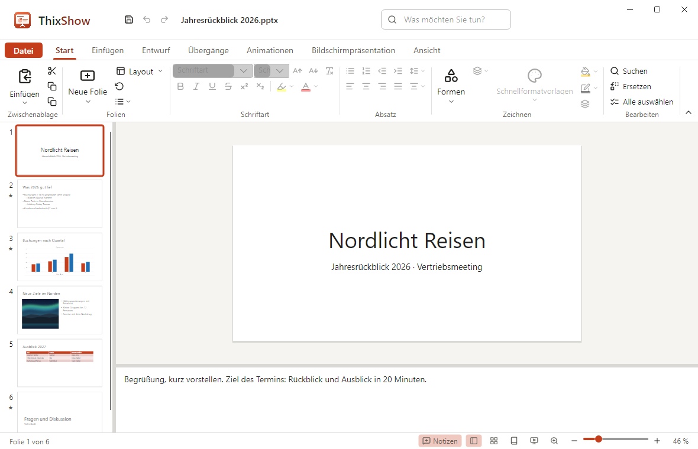

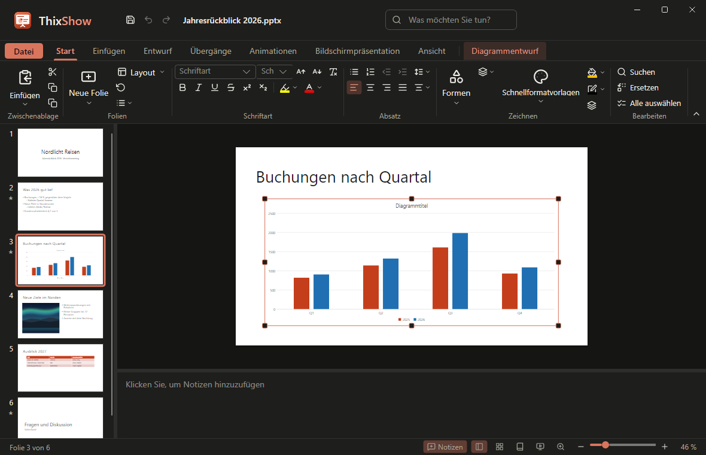

| Diagramm auf der Folie | Formen-Galerie |
| --- | --- |
| 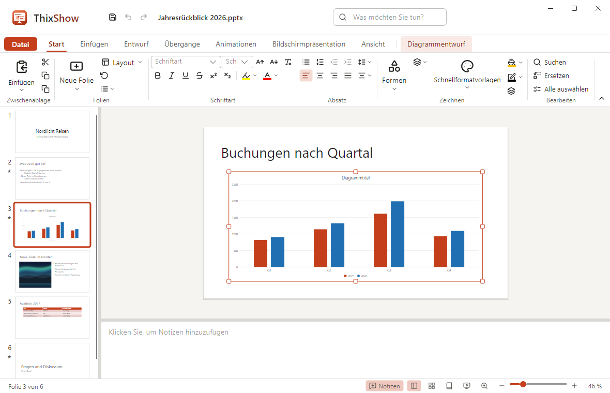 | 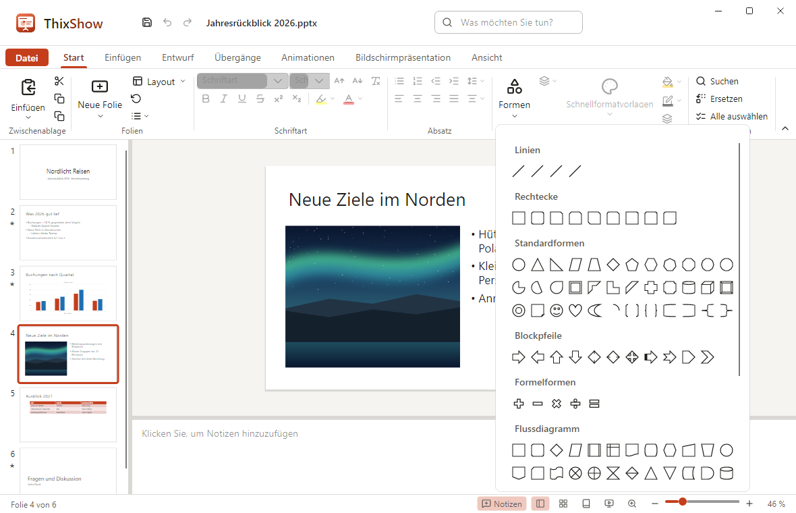 |
| **Entwurf: Designs** | **Übergänge** |
| 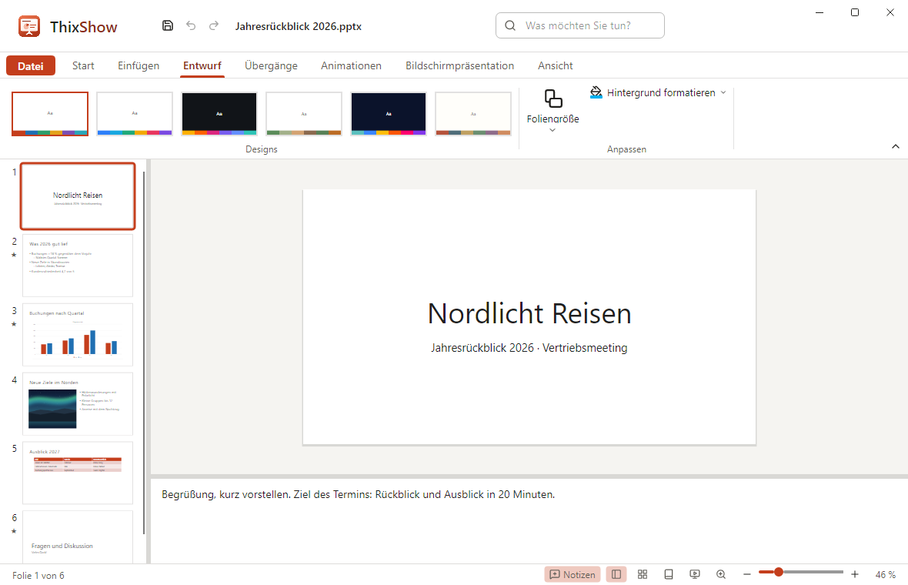 | 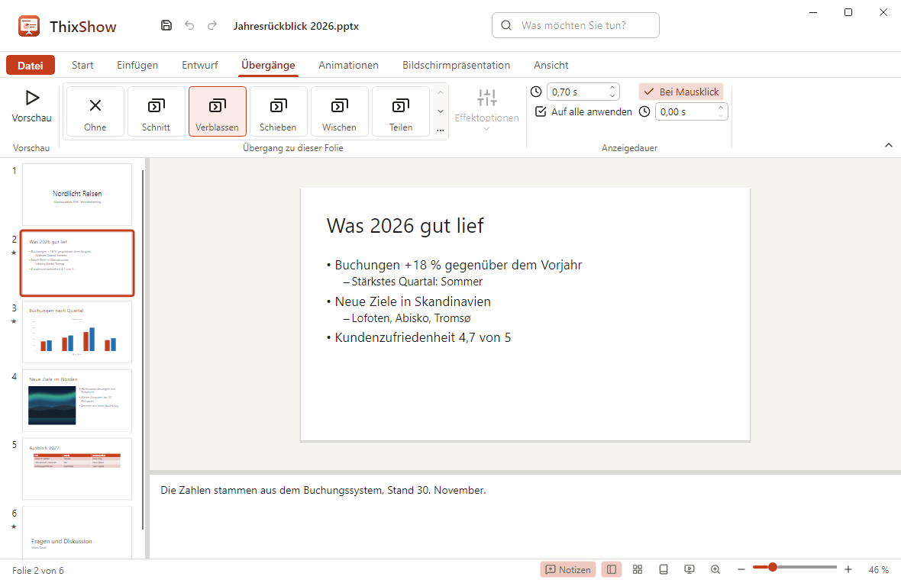 |
| **Animationen mit Animationsbereich** | **Foliensortierung** |
| 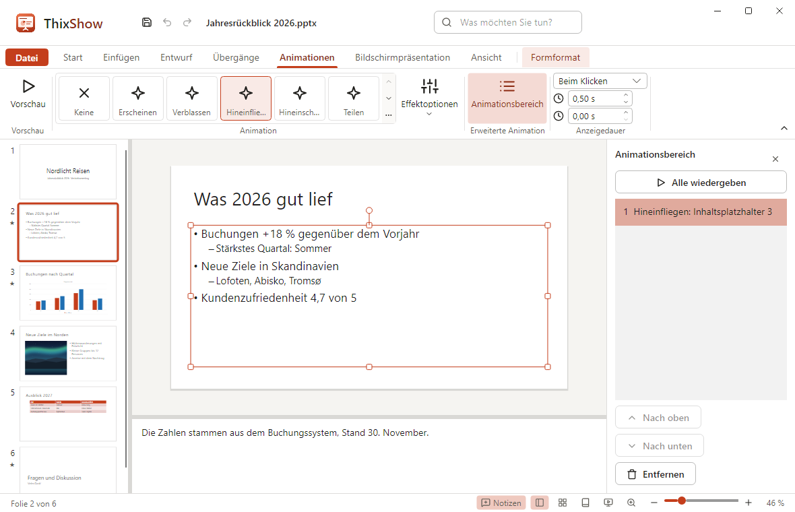 | 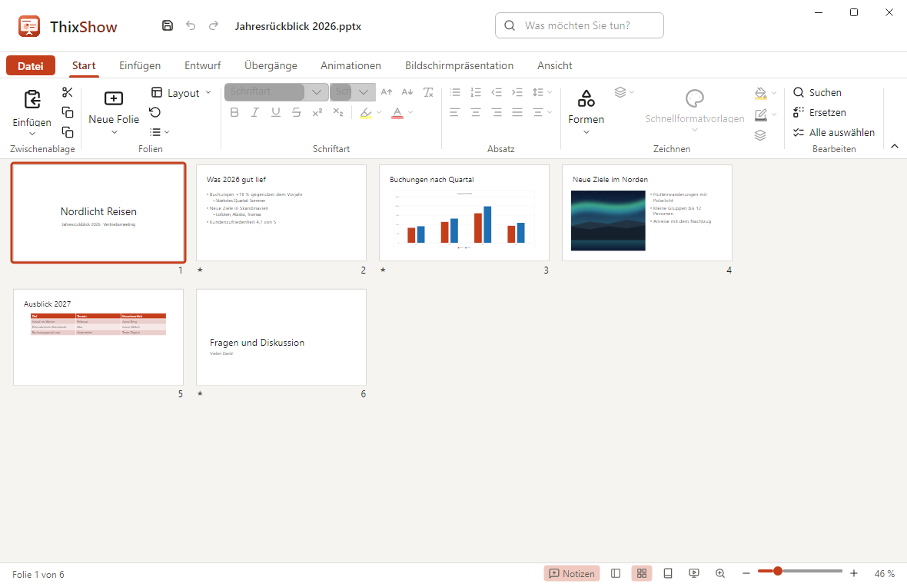 |
| **Referentenansicht** | **Datei › Drucken** |
| 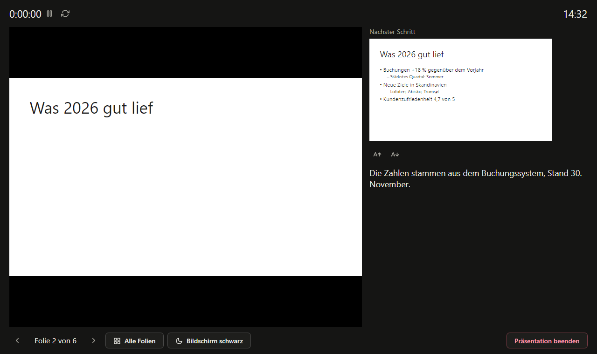 | 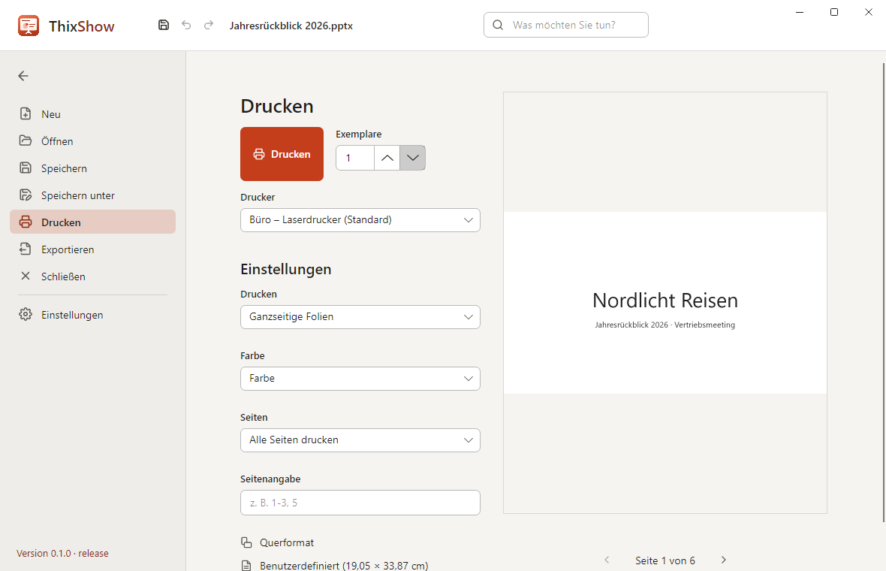 |

### Tastenkürzel in ThixShow

Wie im deutschen PowerPoint (unter macOS ⌘ statt Strg):

| Kürzel | Befehl |
| --- | --- |
| Strg+M, Strg+D | Neue Folie, Duplizieren (Formen oder Folien) |
| F5 / Umschalt+F5 (⇧⌘↩ / ⌘↩) | Bildschirmpräsentation von Beginn an / ab aktueller Folie |
| Strg+Umschalt+F / K / U (auch Strg+B / I / U) | Fett / Kursiv / Unterstrichen |
| Strg+L / E / R / J | Linksbündig / Zentriert / Rechtsbündig / Blocksatz |
| Strg+Umschalt+. / , | Schriftgrad vergrößern / verkleinern |
| Strg+Leertaste | Zeichenformatierung löschen |
| Tab / Umschalt+Tab, Alt+Umschalt+→ / ← | Listenebene tiefer / höher |
| Strg+G / Strg+Umschalt+G | Gruppieren / Gruppierung aufheben |
| Strg+Umschalt++ / Strg+Umschalt+- | In den Vordergrund / In den Hintergrund |
| Pfeiltasten (Strg: fein), Entf, Tab, Eingabe/F2, Esc | Formen verschieben, löschen, nächste Form, Text bearbeiten, Auswahl aufheben |
| Strg+A, Strg+C/X/V, Strg+Umschalt+V | Alles markieren, Zwischenablage, Nur den Text übernehmen |
| Strg+F / Strg+H, Strg+K, Strg+P | Suchen / Ersetzen, Link, Drucken |
| Präsentation: Leertaste, →, ↓, Bild ab, N / Rücktaste, ←, ↑, Bild auf, P | Weiter / Zurück |
| Präsentation: Nummer + Eingabe, Pos1, Ende, B, W, Esc | Zu Folie, erste/letzte Folie, schwarzer/weißer Bildschirm, beenden |

## ThixContacts – erste Version

ThixContacts ist das Adressbuch der Suite – Outlooks „Personen“ als eigenes Programm. Anders als Word, Excel und PowerPoint hat es keine
Dokumente: **ein Hauptfenster** über Ihren Kontakten (ein zweiter Start holt es nach vorn), gespeichert sofort und ohne Nachfrage in einem lokalen
Bestand (SQLite). Es arbeitet **ohne ThixCloud** nur auf diesem Computer; nach der Anmeldung unter *Datei › Einstellungen › Cloud* gleicht es die
Kontakte mit der ThixCloud ab – auf allen Geräten gleich, auch im Browser (MatCloud `/Contacts`) und später in ThixMail.

- **Liste** wie in Outlook: links der Ordnerbereich (Alle Kontakte, Favoriten, Kontaktgruppen, Kategorien mit Farben), in der Mitte die Liste mit
  Suche (Name, E-Mail, Telefon – auch nur die Ziffern –, Firma, Kategorie), Sortierung nach Vorname, Nachname oder Firma und dem Alphabet zum
  Springen; flüssig auch mit 50.000 Kontakten. Rechts die Kontaktkarte mit Bearbeiten, E-Mail und Favorit.
- **Kontakt** in den Registerkarten Allgemein | Details | Notizen: Anrede, Vor-, weitere Vor- und Nachname, Namenszusatz, Anzeigename, Firma,
  Abteilung, Position; beliebig viele E-Mail-Adressen, Telefonnummern, Adressen und Webadressen mit ihrer Art (Geschäftlich, Privat, Mobil …),
  Geburtstag und Jahrestag (auch ohne Jahr), Spitzname, Kategorien, Gruppen, Bild aus einer Datei. Falsche Werte stehen an ihrem Feld.
- **Kontaktgruppen** anlegen, umbenennen, löschen, Mitglieder hinzufügen und entfernen, „E-Mail an Gruppe“.
- **Dubletten** finden (derselbe Name, eine gleiche E-Mail-Adresse oder Telefonnummer – auch +49 und 0049 gleich) und **Feld für Feld
  zusammenführen**; Gruppen folgen dem behaltenen Kontakt.
- **Importieren** aus vCard 2.1/3.0/4.0 (Outlook, Apple, Google, mit Bildern) und CSV (Spalten werden zugeordnet – deutsche und englische
  Outlook-Spaltennamen werden erkannt), auf Wunsch ohne Dubletten; ein Doppelklick auf eine .vcf importiert sie. **Exportieren** als vCard 3.0, 4.0
  oder CSV – alle oder die ausgewählten. **Drucken** als Liste oder Karten, **Als PDF speichern**.
- **Löschen** mit „Rückgängig“ in der Meldungsleiste; jede Änderung lässt sich rückgängig machen.

Tastenkürzel: Strg+N neuer Kontakt · Strg+Umschalt+L neue Kontaktgruppe · F2 oder Eingabe bearbeiten · Entf löschen · Strg+E / Strg+F suchen ·
Strg+A alle · F9 jetzt synchronisieren · Strg+P drucken · Strg+Z / Strg+Y rückgängig / wiederholen (auf dem Mac ⌘ statt Strg).

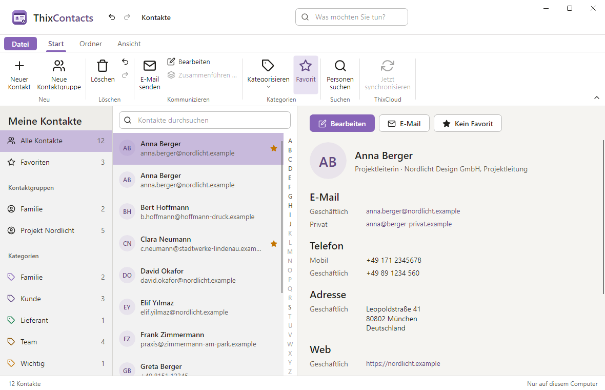

| | |
| --- | --- |
| 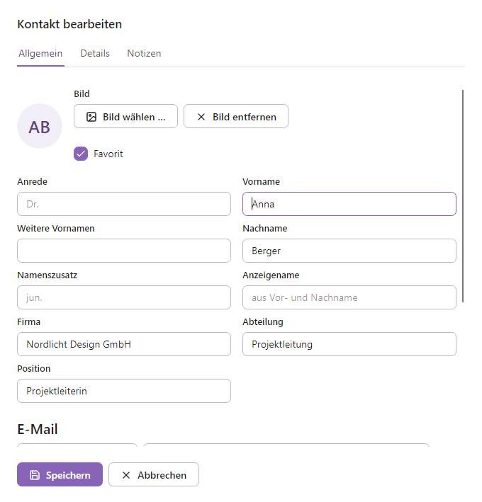 | 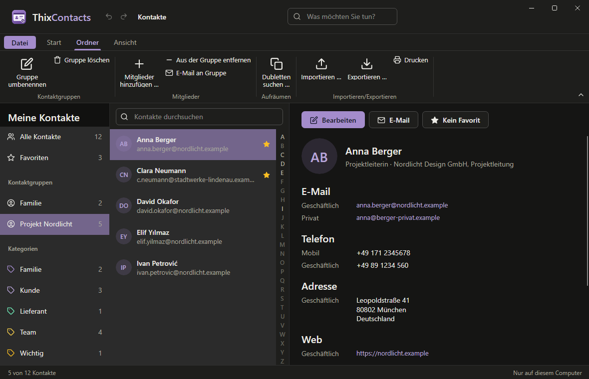 |
| 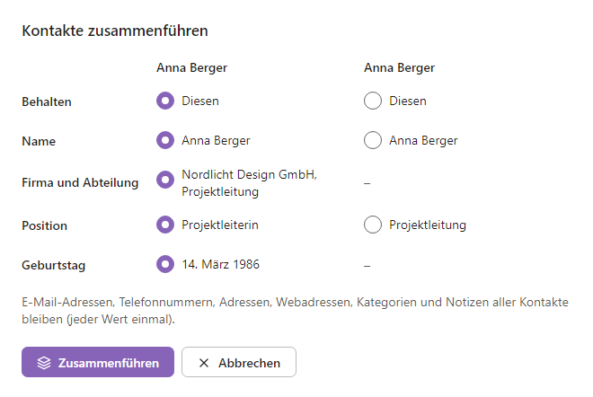 | 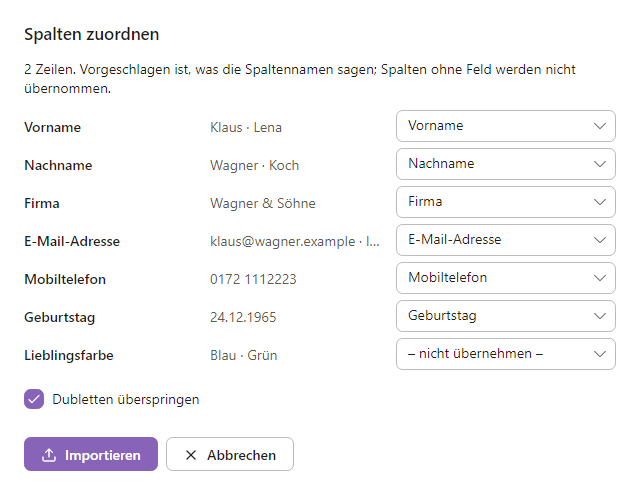 |
## ThixCloud und ThixDrive

ThixWrite, ThixCalc und ThixShow öffnen und speichern Dokumente direkt in **ThixDrive**, der Ablage Ihrer **ThixCloud** (MatCloud) – auf
jedem Computer und im Browser.

**Verbinden:**

1. *Datei › Einstellungen › Cloud* (oder *Datei › Öffnen › ThixDrive*): die Adresse Ihrer ThixCloud eintragen
   (z. B. `https://cloud.example.com`).
2. **Im Browser anmelden** (empfohlen, für jedes Konto, auch über MatIdentity): ThixWrite zeigt einen Code und öffnet die
   Anmeldeseite; dort anmelden und prüfen, dass derselbe Code steht – ThixWrite verbindet sich, sobald Sie bestätigen.
   Oder **Mit Benutzername und Passwort** eines Kontos der ThixCloud. Das Passwort wird nur für die Anmeldung verwendet und nie
   gespeichert; das Geräte-Token liegt geschützt (Windows: DPAPI, macOS: Schlüsselbund).
3. Hat **ThixLauncher** ThixWrite installiert, ist es beim ersten Start schon angemeldet.

Abmelden unter *Einstellungen › Cloud* entfernt diesen Computer aus Ihrem Konto; Ihre Dokumente bleiben, wo sie sind.

**Arbeiten:** *Datei › Öffnen* und *Datei › Speichern unter* haben die Orte „Zuletzt verwendet“, „ThixDrive“ und „Dieser PC“.
In ThixDrive suchen Sie über die ganze Ablage, filtern nach Typ, sortieren, legen Ordner an, benennen um und legen in den
Papierkorb (30 Tage, im Browser wiederherstellbar). Strg+S speichert ein ThixDrive-Dokument zuerst auf diesem Computer, dann
als neue Version in ThixDrive; oben rechts in der Titelleiste steht, wo es steht („In ThixDrive“, „Wird hochgeladen …“).

- **Ohne Verbindung geht nichts verloren:** Das Dokument bleibt gespeichert (als Arbeitskopie auf diesem Computer) und ist als
  **„Nicht hochgeladen“** markiert; ThixWrite versucht es alle 30 Sekunden erneut, ein Klick darauf sofort. Beim Schließen
  fragt ThixWrite nach; wer trotzdem schließt, dem wird es beim nächsten Öffnen hochgeladen.
- **Hat jemand die Datei inzwischen geändert**, fragt ThixWrite: **Als Kopie speichern** (Vorschlag – beide Fassungen bleiben),
  **Später** oder – abgesetzt – **Überschreiben** (Ihre Fassung wird die aktuelle; die andere bleibt als ältere Version).
- Ist der Speicherplatz voll oder die Datei zu groß, sagt ThixWrite das; das Dokument bleibt auf diesem Computer gespeichert.

| | |
| --- | --- |
|  | 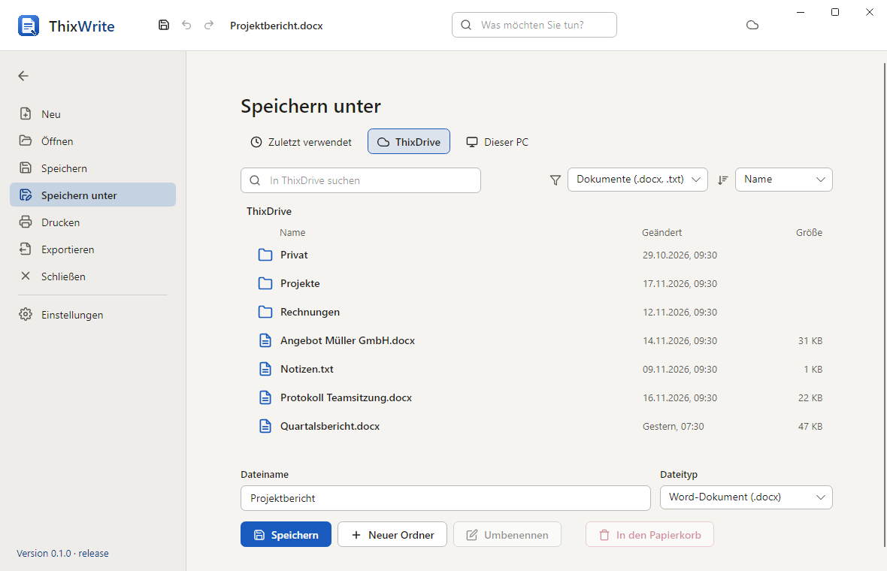 |
|  | 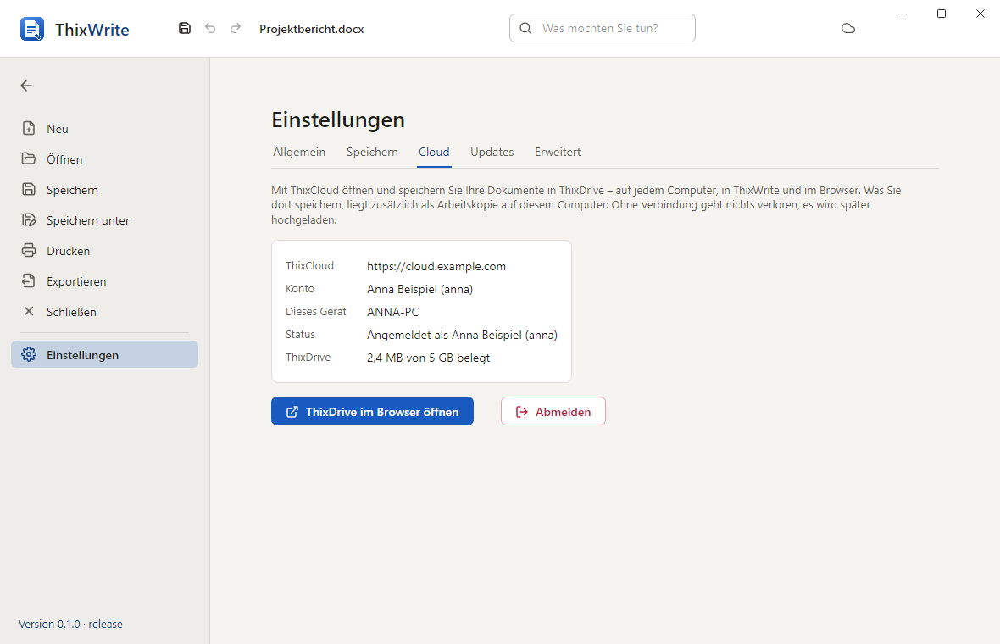 |
|  |  |

### Tastenkürzel

Wie im deutschen Word, wo sie nicht kollidieren (unter macOS ⌘ statt Strg, ⌥ für Wort-Bewegungen):

| Kürzel | Befehl |
| --- | --- |
| Strg+Umschalt+F / K / U (auch Strg+B / I / U) | Fett / Kursiv / Unterstrichen |
| Strg+L / E / R / J | Linksbündig / Zentriert / Rechtsbündig / Blocksatz (Strg+B ist Fett, nicht Blocksatz) |
| Strg+Leertaste (⇧⌘Leertaste) | Formatierung löschen |
| Strg+F / Strg+H (⌥⌘F) | Suchen / Ersetzen |
| Strg+A, Strg+C/X/V, Strg+Umschalt+V | Alles markieren, Zwischenablage, Nur Text einfügen |
| Strg+Eingabe, Umschalt+Eingabe | Seitenumbruch, Zeilenumbruch |
| Tab / Umschalt+Tab | in Listen: Ebene tiefer / höher; in Tabellen: nächste / vorige Zelle (Tab in der letzten Zelle: neue Zeile) |
| Alt+Umschalt+D | Datum und Uhrzeit |
| Strg+P | Drucken |
| Strg+K, Strg+Klick | Link einfügen, Link öffnen |
| Strg+D | Schriftart … |
| Strg+Umschalt+C | Format übertragen |
| Esc (in Kopf-/Fußzeile) | zurück zum Text |
| Strg+Z / Strg+Y (⇧⌘Z), Strg+S, F12, Strg+F1 | Rückgängig / Wiederholen, Speichern, Speichern unter, Menüband |

## Installieren

- **Windows:** `ThixWriteSetup.exe`, `ThixCalcSetup.exe`, `ThixShowSetup.exe` bzw. `ThixContactsSetup.exe` aus dem Release-Kanal herunterladen und starten. Das Programm installiert sich selbst für
  das eigene Benutzerkonto (ohne Administratorrechte) nach `%LocalAppData%\Programs\ThixWrite`, trägt sich im Startmenü, unter
  „Installierte Apps“ und unter „Öffnen mit“ für alle Dateitypen ein, die es öffnet (ThixWrite: .docx, .odt, .txt). Das Setup
  fragt, ob eine Desktop-Verknüpfung entstehen soll, ob Updates automatisch installiert werden und welche Dateitypen die App
  standardmäßig öffnet (vorausgewählt nur das eigene Format: .docx, .xlsx bzw. .pptx). Eine Wahl, die Sie selbst unter „Öffnen
  mit“ / „Standard-Apps“ getroffen haben, bleibt. Entfernen über „Installierte Apps“.
- **macOS:** `ThixWrite-macOS-arm64.dmg` (Apple Silicon) bzw. `-x64.dmg` (Intel) öffnen und ThixWrite in „Programme“ ziehen.
- Updates kommen automatisch aus dem eigenen Kanal (`release-channel` für main, `nightly-channel` für dev) und werden
  installiert, wenn ThixWrite geschlossen wird – nie mitten in der Arbeit.
- ThixLauncher kann die Apps installieren (je App eigenes Manifest `<app>-update.json`, siehe Plan Abschnitt 6).

**Ohne Fenster** (ThixLauncher, ThixInstall, Administratoren) – die Optionen des Setups als Argumente (MatDesign SETUP-05/08;
was angeboten wird, steht in `src/<App>/installer.json` und im Update-Manifest unter `installer`):

```
ThixWriteSetup.exe --quiet --desktop-shortcut=yes --automatic-updates=yes --file-types=.docx,.odt [--start]
ThixWrite.exe --configure --file-types=none     # nur anwenden (macOS: ThixWrite.app/Contents/MacOS/ThixWrite --configure …)
ThixWrite.exe --uninstall --quiet
```

`--file-types` nimmt Endungen (mit oder ohne Punkt), `none` oder `default`. Nicht angegebene Optionen: bei der
Erstinstallation der Standard, bei einem Update bleibt es, wie es ist. Ein falscher Wert oder eine Option, die die App nicht
anbietet (z. B. `--autostart=yes`), bricht mit Exit-Code 2 ab, ohne etwas zu installieren.


## Für Administratoren

Richtlinien je App (Wert 1 = an): Windows `HKLM\SOFTWARE\Policies\ThixWrite` (DWORD), macOS ein Konfigurationsprofil für
`info.schmoldt.thixwrite` – `LockConfiguration` (Einstellungen gesperrt), `DisableUpdates`, `DisableCloud` (keine Anmeldung
an der ThixCloud, kein ThixDrive), `DisableFileAssociations`, `DisablePrinting`. In der ThixCloud selbst lässt sich ThixDrive (oder
die App) für alle abschalten; ThixWrite zeigt dann „von der Verwaltung abgeschaltet“.

## Entwickeln

```
dotnet build ThixOffice.slnx
dotnet test ThixOffice.slnx
dotnet run --project src/ThixWrite                      # mit THIXWRITE_DATA_DIR=<Ordner> eine eigene Instanz
dotnet run --project src/ThixWrite -- --snapshot shots  # alle Fenster hell und dunkel als PNG
dotnet run --project src/ThixCalc                       # ThixCalc (THIXCALC_DATA_DIR=<Ordner>, --snapshot <Ordner> ebenso)
dotnet run --project src/ThixContacts                   # ThixContacts (THIXCONTACTS_DATA_DIR=<Ordner>, --snapshot <Ordner> ebenso)
dotnet run --project src/ThixShow                       # ThixShow (THIXSHOW_DATA_DIR=<Ordner>, --snapshot <Ordner> ebenso)
cd tools && npm install && node render-icons.js         # Logos rendern
```

Aufbau, Regeln und wie eine weitere App dazukommt: [CLAUDE.md](CLAUDE.md). Logos: [branding/README.md](branding/README.md).

© Matthias Schmoldt
